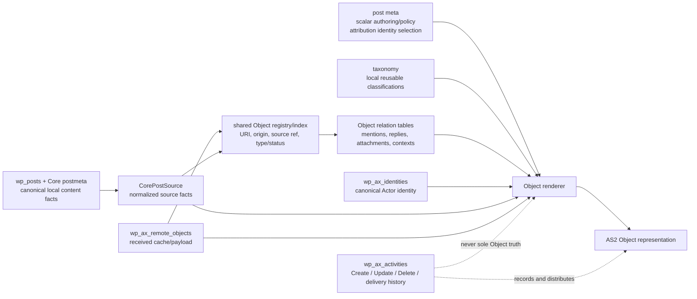

# ActivityStreams Storage Boundaries

**Status:** working proposal, 2026-10-15. This records a storage
classification for local WordPress-backed Objects. It does not introduce a
schema or change a federation policy.

The question is not whether an ActivityStreams property can physically fit in
`wp_postmeta`. The question is what kind of fact it is. One Object response is
assembled from Core sources, local authoring settings, relationship projections,
and protocol history. Those remain different sources even when the renderer
eventually emits adjacent JSON properties.

## Decision Rule

| Store | Use it when | Do not use it when |
|---|---|---|
| Core post fields and Core APIs | WordPress already owns the canonical source fact. | An AS2 property merely resembles a Core column. |
| `wp_postmeta` | One local post owns one small, typed authoring or policy selection. It is edited with that post and has no independent identity. | The value is a list, a graph edge, requires ordering/provenance, or is queried across local and remote Objects. |
| Taxonomy and term meta | A reusable local classification is shared by many posts and has a local archive/editorial identity. | Membership itself is an actor collection, an audience, a reply graph, or a remote source of truth. |
| Axismundi relation table | An Object has zero or more targets, the target may be local or remote, or the edge has origin, order, consent, authorization, visibility, or query requirements. | The relationship is only a Core source fact such as a featured-image attachment ID. |
| Axismundi entity/state table | The record has its own lifecycle, canonical URI, cache/refresh state, retention needs, or is a query projection across Objects. | It is merely a post-specific edit setting. |
| Activity ledger | It is an immutable event: who acted, on what, when, delivery direction, payload, and effective status. | The Object must still answer correctly after activity retention, pruning, or the Activities plugin being unavailable. |
| Renderer / derived projection | The value is deterministically assembled from one of the above at read time. | Rendering would hide a missing durable source fact. |

`meta_value` arrays are especially suspect: they are acceptable as a temporary
editor input, but they are not the durable graph representation of a many-target
AS2 relationship.

## Source Store Versus Shared Registry

Some Object properties need one common query surface even though their source
does not become common. The useful distinction is:

| Layer | Local Object | Remote Object | Purpose |
|---|---|---|---|
| Source record | `wp_posts`, Core post meta/APIs, and narrowly owned authoring meta | `wp_ax_remote_objects` payload/cache | Preserves the source's native semantics and refresh/edit lifecycle. |
| Shared Object registry/index | One row referring to the local post and its canonical Object URI | One row referring to the remote cache row and canonical Object URI | Cross-origin lookup, graph edges, collections, actor/object queries, and rebuildable listing projections. |

This is a good place for common *indexable identity facts*: canonical Object
URI/hash, origin (`local` or `remote`), source reference, Object type/status,
and an optional resolved Actor identity reference. It is not a place to copy
local `post_content`, editorial dates, arbitrary raw JSON, or every AS2 field.
Those remain in their source stores and are rendered or cached through explicit
projections.

### What the Registry Simplifies

Once every visible Object has one registry `object_id`, extension modules no
longer need a separate local-post path and remote-cache path. Their tables can
refer to one ID and let the registry find the source:

```text
wp_ax_objects              object_id -> origin + source reference + canonical URI
wp_ax_object_tag_relations object_id -> tag descriptor / optional local term
wp_ax_object_relations     object_id -> target object / relation metadata
wp_ax_object_audience      object_id -> recipient / addressing role
wp_ax_object_collections   object_id -> collection / position / membership state
module-owned extension     object_id -> typed module facts
```

That simplifies indexing, cleanup, and joins. A cache purge, local post delete,
or source refresh can locate every rebuildable projection by one stable registry
reference. It also makes a common Object card/list query independent of whether
the source was local or remote.

It does **not** make `wp_postmeta` obsolete. Local editor-owned inputs stay
there until they are normalized into a shared projection; remote unrecognized
extensions stay in the received payload. Avoid a generic
`object_id + property_name + property_value` table as the primary model: it
would turn typed relationships, indexes, ordering, and authorization into an
unbounded EAV schema. Add a typed common column or a module-owned table only
after naming the query, lifecycle, and source-of-truth contract it serves.

### Activity Ledger Deduplication Requires Revisions

The registry's strongest operational use is to stop storing a full Object
snapshot in every inbound and outbound Activity row. A Create, Update, Announce,
delivery retry, and inbox observation can all refer to the same canonical
`object_id`.

The registry alone is insufficient, however. Resolving a 2026 Create against
the Object's current representation after a 2027 edit would rewrite history.
The deduplication unit must therefore be an immutable representation revision:

```text
wp_ax_objects
  object_id, canonical_uri/hash, origin, source reference, current_revision_id

wp_ax_object_revisions
  revision_id, object_id, representation_hash, representation_json or blob ref,
  observed_at, source_kind, immutable, expires_at, retention_reason

wp_ax_activities
  activity identity/type, actor reference, object_id, object_revision_id,
  audience/direction/signature-or-delivery evidence, event timestamps
```

For a local Object, a revision records the exact federated representation used
by an outbound Create or Update; the mutable post remains its present source.
For a remote Object, an inbound embedded Object or direct fetch may create or
reuse a revision by representation hash; the remote cache points to the newest
usable revision. Repeated deliveries and retries then reference one revision
instead of copying its object JSON.

An Activity still needs an immutable event envelope. It cannot be reduced to
only `object_id`: activity type, actor, audience, direction, timestamps,
verification/delivery evidence, and a hash of the received or emitted activity
remain event facts. Raw activity payload retention can be shorter or moved to a
content-addressed audit store, but dropping it is a server operating-policy
decision, not merely a normalization optimization.

Revisions need an explicit retention policy rather than permanent storage. A
revision is retained while an active delivery/retry, moderation case, object
lease, or configured audit window requires its exact representation. On expiry,
delete the representation body/blob but retain the Activity envelope,
`representation_hash`, expiry timestamp, and a reason such as
`representation_expired`. Historical activity can then remain auditable without
pretending its former Object body is still available. Tombstone/minimal lifecycle
facts may have a longer policy than rich content, but the duration is an
operator decision to document before implementing the tables.

### Actor Profiles Are a Separate Revision Case

Actor profiles are ActivityStreams Objects, but their default job is to express
the *current* identity/profile. Do not put every profile fetch or local edit
into the generic Object revision store indefinitely. The Actors identity/actor
tables should retain the current normalized profile and a profile hash; create a
short-lived immutable profile representation only when an inbound or outbound
`Update` needs retry, moderation, forensic review, or an audit window.

Cryptographic and endpoint observations require their own retention rules:
public-key identifier/fingerprint, validity/observation interval, inbox and
shared-inbox endpoint history, and signature-verification evidence are not
ordinary display-profile revisions. Never retain replaced private key material
as a profile revision. An Actor Tombstone or disabled state may keep minimal
identity/lifecycle evidence after rich profile data expires.

An observed remote Object can name an Actor before that Actor is cached. The
registry therefore needs to retain the unresolved `attributed_to_uri`/hash (or
obtain it through the remote cache) and permit a nullable resolved
`attributed_to_identity_id`; it must not require actor discovery before Object
storage. When discovery later succeeds, it fills the identity reference without
rewriting the observed URI.

The existing `wp_ax_object_index` is a partial listing projection and
`wp_ax_remote_objects` is the remote source/cache. A future unified registry
must either replace that index deliberately or make their responsibilities
explicit; it must not become a third, silently divergent copy of Object state.

## Current Implementation Facts

| Current source | What it holds | Boundary observation |
|---|---|---|
| `wp_posts` and Core attachment APIs | local text, title, excerpt, MIME family, dates, attachment file/metadata, featured image source | Correct substrate for the planned shared `CorePostSource`; attachment remains a Core `post_type`. |
| OP post meta | `_ax_op_sensitive`, `_ax_op_content_warning`, `_ax_op_quote_policy`, `_ax_op_visibility`, `_ax_op_mentions`, `_ax_op_language` | The scalar settings fit post meta. `_ax_op_mentions` is an editor input, while the actual query projection is already a relation table. |
| `ax_hashtag` taxonomy | local/observed hashtag vocabulary, local post membership, canonicalized term key | Appropriate for this site's reusable tag archive; it is not an Actor collection. |
| `wp_ax_object_mentions` | Object-to-Actor URI edges and origin (`explicit`, `inline`, `remote`) | Correct relationship-table shape. |
| `wp_ax_object_relations` | Object-to-Object quote edges plus evidence, consent and authorization | Correct relationship-table shape. |
| `wp_ax_remote_objects` | remote Object cache, scalar lookup fields, payload and refresh/cache state | Correct entity/cache shape; its `attributed_to_uri` is remote observation, not a local post setting. |
| `wp_ax_activities` | Create/Update/Delete and other activity payload/history/direction/audience | Currently also supplies local `attributedTo`; that makes durable Object attribution depend on the ledger and is the boundary to remove. |

## Proposed Property Classification

`AS2` below means the ActivityStreams Vocabulary property. “No new generic
store” means a type-owning module may later define a narrow contract; it does
not authorize an untyped global meta key.

| AS2 property or family | Local WordPress-backed Object | Remote Object | Store / owner |
|---|---|---|---|
| `id`, `url`, `type` | Derive from routing plus `WP_Post.ID`, `post_type`, MIME classification. | Cache canonical URI/type and received human URL. | Core adapter / remote-object cache; no post meta. |
| `name`, `content`, `summary` | `post_title`, raw `post_content`, `post_excerpt`; transformation/sanitization belongs after source reading. | Cache scalar received representation plus payload. | Core adapter / remote cache. |
| `published`, `updated` | Core GMT dates, subject to a later representation contract. | Cached remote timestamps. | Core adapter / remote cache. |
| `mediaType`, image dimensions, rendition links | Read Core attachment metadata and a media-policy resolver. | Preserve payload and cache selected scalars when needed. | Core APIs plus media policy; no duplicate raw Core-meta copy. |
| `attributedTo` | **Proposed:** one `_ax_object_attributed_to_identity_id` post-meta value referencing the Actors identity ledger. Its URI is resolved at render time. | Preserve URI/hash in `wp_ax_remote_objects`; resolve/cache the Actor independently. | Post meta for local selection; remote cache for observation; identity table for referenced entity. |
| `sensitive`, content warning, quote preference, language | Existing typed scalar OP meta remain suitable authoring settings. | Preserve received payload/scalars; do not apply local authoring meta. | Post meta / remote cache. |
| Visibility intent versus `to`/`cc`/`bto`/`bcc`/`audience` | A compact local visibility policy may remain scalar post meta. Resolved recipients and delivery audience are not the same fact. | Preserve received addressing in payload; index only explicit query needs. | Policy plus recipient/audience relation tables and activity delivery history; not an authoritative post-meta URI array. |
| `tag` as local hashtag/topic | Use a local taxonomy when this site owns a reusable classification and archive. | Map to a local term as an explicit shared vocabulary/index projection, while retaining the received `tag` payload as the remote source. | Taxonomy/term meta; current `ax_hashtag` plus `wp_ax_remote_object_hashtags` is this case. |
| `tag` as `Mention` | Explicit editor input may temporarily enter through meta, but the durable result is edges. | Extract received Mention tags to edges without synchronously fetching Actors. | `wp_ax_object_mentions` or successor relation table. |
| other `tag` members: `Link`, emoji, custom types, unknown extensions | Do not silently make them terms. A module may define a local taxonomy-backed kind only when it owns its vocabulary and archive semantics. | Preserve the received descriptor and index a kind only when a concrete query needs it. | Generic tag-relation projection, with optional `term_taxonomy_id`; raw payload remains the lossless source. |
| `attachment`, `image`, `icon`, `preview` | Parse links/attachment IDs into relation/representation projections; `_thumbnail_id` remains a Core source for the singular featured image. | Preserve payload; index only retrieval-critical edges. | Core resolver for featured image; relation table for general/multiple edges. |
| `inReplyTo`, `context`, `partOf`, `replies` | Do not use `post_parent`. Store durable object/collection edges once the local authoring contract exists. `replies` itself is a derived collection/query. | Cache direct URI scalars where useful and retain payload; graph/index is separate. | Object-relation and collection-membership tables; renderer for collection pages/counts. |
| `oneOf`, `anyOf`, `closed` | Question-specific state; options are ordered, multiple, and independently addressed. | Preserve received payload. | Question module tables, not generic meta arrays. |
| `startTime`, `endTime`, `duration`, coordinates, radius | Type-specific Event/Place/Media facts. A single scalar can be module-owned post meta; a reusable Place/independent object needs its own entity and edges. | Cache typed scalar fields only if queried. | Owning type module; no generic OP meta until that contract exists. |
| `location`, `origin`, `target`, `instrument`, `result` | Usually a typed relation rather than an unqualified string. | Preserve payload and selectively index. | Relation table with `relation_type`, target URI/hash, and edge metadata. |
| `generator` | Site/application configuration. | Received payload fact. | Site option/configuration; remote payload. |
| Collection paging: `current`, `first`, `last`, `next`, `prev`, `items`, `orderedItems`, `totalItems`, `startIndex` | Derived from a collection query and its membership/order. | Cached remote collection page only when explicitly fetched. | Dedicated collection/membership tables and renderer; never taxonomy membership alone. |
| `formerType`, `deleted` / Tombstone | Requires an operator policy for local retention, withdrawn federation state, and HTTP representation. | Cache Tombstone payload/status. | Lifecycle/entity state table plus activity ledger; defer schema until policy exists. |
| `accuracy`, `altitude`, `latitude`, `longitude`, `units`, `width`, `height`, `href`, `hreflang`, `rel` | Representation-specific or typed-module facts. | Preserve received representation. | Derived attachment/link representation or typed owner; no generic post meta. |
| `subject`, `relationship`, `describes` | Semantic graph edges, not a WordPress category by default. | Preserve/index only a concrete query case. | Relation table. |

The AS2 vocabulary also permits extension properties. `contentMap`, `nameMap`,
and `summaryMap` are not Vocabulary properties. A single local language override
can influence one rendered representation, but genuine multilingual maps need a
translation-owner model with per-language rows, not serialized post meta.

## Shape of the Proposed Local Path



The proposed local attribution path is deliberately direct:

```text
editor chooses authorized Actor identity
  -> post meta stores identity_id
  -> Core/Object projection resolves canonical Actor URI
  -> Object.attributedTo
  -> Create/Update command records the actor and delivery event
```

That lets a scheduled post render its attribution without an active user session
or a retained Create row. `post_author` and `_edit_last` remain WordPress
editorial facts; changing either must not silently reassign `attributedTo`.

The Actors plugin's per-user acting-actor preference is a compose/UI default,
not the post's source of truth and not an authorization grant. A user may
author a post through an Organization, transfer the WordPress `post_author` to
another user, and retain the Organization attribution. On a later edit, the
editor's current authority is checked against the stored attributed Actor: an
authorized editor may issue the corresponding Update, while an unauthorized
editor can make the local WordPress edit without silently emitting an Update
under an Actor they cannot represent. Reassignment of `attributedTo` is an
explicit post/source command, never an incidental result of an author transfer
or a global UI switch.

## Tag Is a Relation Family, Not a Taxonomy Alias

ActivityStreams `tag` may contain `Hashtag`, `Mention`, `Link`, emoji-shaped
extensions, or other extension types. A local term is therefore an *optional
projection target*, not the universal representation of `tag`.

The current hashtag implementation already indexes remote observations and
merges them with local taxonomy-backed posts in the dedicated archive block.
It cannot use the default WordPress taxonomy query as a single mixed query,
because the remote Object is not a `WP_Post`; it joins
`wp_ax_remote_object_hashtags` to `wp_ax_remote_objects` and merges the two
result sets. This is functional today, but pagination and ranking are still
two-source behavior.

Once a shared Object registry exists, the generalized shape should be an
Axismundi table such as `wp_ax_object_tag_relations`, not a reuse of
`wp_term_relationships`:

```text
object_id                 shared Object registry ID
tag_kind                  hashtag | mention | link | emoji | extension type
term_taxonomy_id          nullable; only when mapped to local vocabulary
target_uri/hash           nullable; Mention/Link/remote tag target
name / observed_name      descriptor/display evidence
source_href               nullable received link evidence
origin                    local-authored | remote-observed | derived
position                  nullable when source ordering matters
UNIQUE(object_id, tag_kind, comparison identity, origin)
```

`ax_hashtag` can become one taxonomy-backed slice of that table. `Mention`
may remain a specialized, actor-targeted projection while sharing the same
registry Object ID. Unknown tags must remain recoverable from the raw source
payload rather than being fabricated into local taxonomy terms.

## Replies Are Objects; Reactions Are Interaction State

Axismundi does not use `wp_comments` as its reply model. A local reply is its
own post-backed Object, and `inReplyTo` is an Object relation edge. It therefore
uses the same source/projection path as a root Article or Note.

`Like`, `Dislike`, `Announce`, and `EmojiReact` are different: they are
Activities that establish an Actor-to-Object interaction. The current
`wp_ax_activities` ledger stores their event rows and queries its active rows
directly; it already carries reaction keys and an aggregate-oriented index.
That is correct for an event record, but it makes every likes/shares/reactions
collection and count depend on a growing history table.

After the shared Object registry exists, materialize current interaction state
instead of making a separate physical table for every collection:

```text
wp_ax_object_interactions
  interaction_id
  target_object_id
  actor_identity_id nullable + actor_uri/hash fallback
  interaction_kind       like | dislike | announce | emoji_react | extension
  reaction_key/raw       nullable; only for reaction kinds
  source_activity_uri/hash
  state                  active | undone | rejected | expired
  occurred_at / updated_at
  interaction_identity   policy/type-specific deduplication key
  indexes: target+kind+state, actor+kind+state, activity URI
```

`Object.likes`, `Object.shares`, an emoji reaction collection, and an Actor's
liked/announced collection are then indexed views over the same edge table,
not independent sources of truth. `Undo` locates the edge by referenced
activity URI and changes its state. The Activity ledger retains the event
envelope; if event payload retention expires, the interaction edge retains the
minimal identity and state needed for current collections until its own policy
expires.

Do not impose one universal `UNIQUE(actor, object, kind)` constraint. A Like
may be one active edge per Actor/Object under a product policy, while emoji
reactions often allow one active edge per Actor/Object/reaction key, and an
extension can define different semantics. The interaction type owns its
deduplication key.

### Collection Ownership

Activity collections and Object collections may share a registry ID and a
renderer, but they do not have the same source of truth:

| Collection family | Source of truth | Owner |
|---|---|---|
| Actor outbox/inbox, activity audit/history, Actor's likes/announces, Object likes/shares/reactions | Activity events plus current interaction-state projection and Undo handling | Activities |
| Object replies, Object graph/context/attachments, local/remote object discovery, taxonomy-backed hashtag archives | Object sources plus Object/relation/tag projections | Object Projections |
| Generic actor/remote collection membership | A future dedicated collection and membership model | Deferred; neither Media folders nor taxonomy owns it by default |

Object Projections should not interpret activity history to count a reaction.
Activities should not decide how a reply post is sourced or rendered. The
boundary is a narrow read contract, for example an Object ID/URI to an
interaction summary and collection URI. This avoids a shared table becoming a
shared ownership boundary.

## Visibility Is Delivery Policy And HTTP Access Policy

An ActivityPub visibility value and permission to read the canonical WordPress
representation are related policies, not the same mechanism. Activities already
owns the authored `public | unlisted | followers | mentioned` Audience policy:
it resolves local Actor visibility into AS2 `to`/`cc`, and Object Projections
uses that result to fail closed for anonymous ActivityStreams negotiation when
an Object is not public. A frontend that has fetched JSON-LD can also make a
viewer-specific presentation decision, but a Block Theme permalink is rendered
by PHP and can otherwise bypass that decision entirely.

Keep the following cases distinct:

| Intent | Server-side fact | Consequence for a WordPress representation |
|---|---|---|
| Core private post | WordPress capability such as `read_private_posts` | Not "all signed-in users"; retain Core semantics rather than reusing it for federation visibility. |
| Members-only local post | A verified WordPress session | A custom access policy can permit any signed-in account, but it must run before the main query/template output and cover permalink, archive, feed, REST, and Object routes. Responses must not be shared by public caches. |
| Followers-only Object | A viewer can be resolved to a local Actor and has a current allowed follow relation to the attributed Actor | A local signed-in viewer can be checked server-side. A remote follower who merely opens an HTML link has no browser proof of its Actor identity, so inbox delivery can be restricted while direct HTML browsing cannot promise the same follower-only guarantee without a separate federated browser-authentication design. |
| Actor/user block | A viewer Actor or local user resolves to a denied relation | Apply the same early representation gate for local sessions. Delivery policy can stop future federation but cannot retract content already fetched or cached remotely. |

`post_status=private` must therefore not mean `followers`. The existing
Audience resolver remains the authority for federation addressing and anonymous
Object disclosure. A future server-owned
`can_view_object(viewer_context, object)` decision must extend it to
viewer-aware WordPress HTTP representations. The frontend consumes that
decision; it must not be its sole enforcement point.

The minimum honest rollout is to distinguish delivery-only followers visibility
from local-session followers visibility. A fully equivalent browser experience
for remote followers requires an identity-proof protocol (for example a
separate sign-in or delegated authentication flow) and is deferred.

### Current Product Scope

The React frontend is the intended reader for the unified local-and-remote
Object model. It receives the normalized Audience/visibility result and makes
the corresponding reader decision; the existing Activities and Object
Projections implementation already supplies federation addressing and the
anonymous Object-route public gate. Applying an Audience-aware authorization
gate to ordinary Block Theme HTML, Core archives, and arbitrary third-party
WordPress queries is explicitly outside the current frontend/Object Projection
slice. It is not an accidental promise made by `_ax_op_visibility`, and it
must not be added piecemeal to a template while calling the result site-wide
access control.

## Deliberately Unresolved

1. Whether the partial `wp_ax_object_index` evolves into a unified Object
   registry, or a new table supersedes it. It may unify cross-origin identity
   and queries, but must not duplicate the canonical Core source without a
   rebuild contract.
2. The local-only, federation-ready, federated, withdrawn, and tombstone
   operator policy. Code currently has lifecycle behavior, but there is no
   unified server operating-policy document to make retention/republication a
   declared product contract.
3. A generic collection model. Actor collections and remote membership cannot
   be modeled as Media Library folders or WordPress taxonomy relationships.
4. Migration of `_ax_op_mentions` from editor-input meta into an explicit
   local edge-authoring contract. The existing index demonstrates why the
   destination is a relation table.
5. The operator-facing visibility contract: which local-only and federated
   visibility states exist, whether followers-only includes local WordPress
   sessions, denial behavior (`404` versus `403`), and cache headers. This is
   a server policy document and enforcement service, not a frontend feature.

## Sources

- [ActivityStreams 2.0 Vocabulary](https://www.w3.org/TR/activitystreams-vocabulary/)
- [Core post source boundary](../plugins/axismundi-object-projections/docs/CORE-WP-OBJECT-SOURCES.md)
- [Local Object lifecycle and attribution contract](../plugins/axismundi-object-projections/docs/LOCAL-OBJECTS.md)
- `axismundi-object-projections/includes/post-settings.php`, `mentions.php`,
  `object-relations.php`, `hashtags.php`, and `remote-objects.php`
- `axismundi-activities/includes/repository.php`

