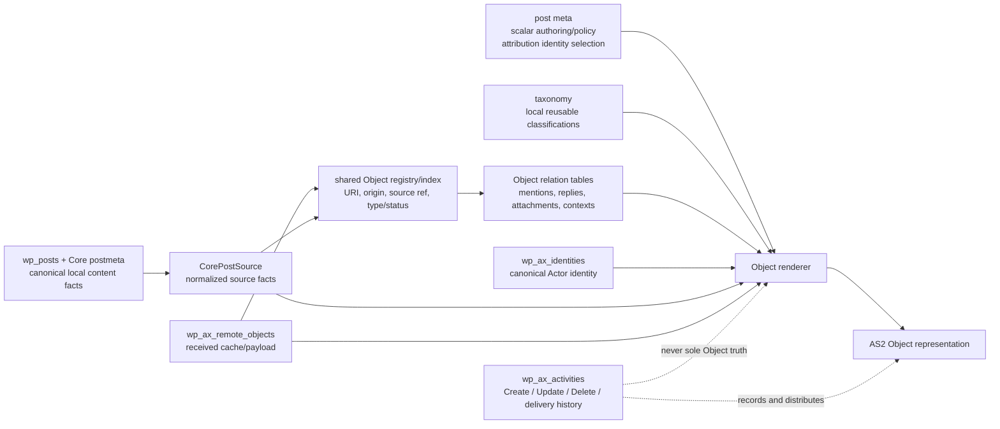

# ActivityStreams Storage Boundaries

**Status:** working proposal, 2026-10-15. This records a storage
classification for local WordPress-backed Objects. It does not introduce a
schema or change a federation policy.

The question is not whether an ActivityStreams property can physically fit in
`wp_postmeta`. The question is what kind of fact it is. One Object response is
assembled from Core sources, local authoring settings, relationship projections,
and protocol history. Those remain different sources even when the renderer
eventually emits adjacent JSON properties.

## Decision Rule

| Store | Use it when | Do not use it when |
|---|---|---|
| Core post fields and Core APIs | WordPress already owns the canonical source fact. | An AS2 property merely resembles a Core column. |
| `wp_postmeta` | One local post owns one small, typed authoring or policy selection. It is edited with that post and has no independent identity. | The value is a list, a graph edge, requires ordering/provenance, or is queried across local and remote Objects. |
| Taxonomy and term meta | A reusable local classification is shared by many posts and has a local archive/editorial identity. | Membership itself is an actor collection, an audience, a reply graph, or a remote source of truth. |
| Axismundi relation table | An Object has zero or more targets, the target may be local or remote, or the edge has origin, order, consent, authorization, visibility, or query requirements. | The relationship is only a Core source fact such as a featured-image attachment ID. |
| Axismundi entity/state table | The record has its own lifecycle, canonical URI, cache/refresh state, retention needs, or is a query projection across Objects. | It is merely a post-specific edit setting. |
| Activity ledger | It is an immutable event: who acted, on what, when, delivery direction, payload, and effective status. | The Object must still answer correctly after activity retention, pruning, or the Activities plugin being unavailable. |
| Renderer / derived projection | The value is deterministically assembled from one of the above at read time. | Rendering would hide a missing durable source fact. |

`meta_value` arrays are especially suspect: they are acceptable as a temporary
editor input, but they are not the durable graph representation of a many-target
AS2 relationship.

## When An Activity Type Gets Its Own Table

The Activity ledger holds twenty-two types in one table with type-specific
indexes, which is `wp_posts` with `post_type` by another name. That analogy
carries its warning with it: Core's one table also holds menus, blocks,
templates and revisions, and every query since has paid for it with a
`post_type` condition. Three splits have already been argued one at a time in
this document, so the rule that decided them is written here instead of being
rediscovered a fourth time.

> Split when the row's **shape** differs or its **lifetime** differs. Volume
> alone is an index problem.

| Types | Shape | Lifetime | Result |
|---|---|---|---|
| `Announce`, `Like`, `Follow`, `Undo`, … | audience, delivery, payload, all used | event, compactible | one ledger, split by index |
| `View`, `Listen`, `Read` | registry row when published; a relation row always | derivable, recountable | relation projection |
| `Question` | option rows, tallies, trash and restore | durable, never compacted | own table |
| `Arrive`, `Travel` | same as an Announce: momentary, addressed | event, compactible | the ledger |

The last row is what the rule is for. `Arrive` and `Travel` sit beside
`Question` in the AS2 type tree and invite the same treatment, but their rows
look and live like an `Announce`. The shape decides, not the taxonomy.

This does not predetermine the storage for a future calendar-backed Travel
product. The Calendar plugin already keeps a durable Event source (`ax_event`
plus schedule data) and projects ActivityStreams Event and JSCalendar as
reads; its Join, Accept, Reject, and Undo records remain ledger facts. A
momentary, event-first Travel can remain a ledger Activity. Travel that needs
authoring, editing, scheduling, restoration, and calendar display needs an
equally durable Calendar-owned source. Do not choose that source's CPT or table
shape until that product contract exists.

One consequence of splitting is worth stating before it is discovered. AS2's
own example announces an `Arrive`, so an Activity can be another Activity's
object, and anything a peer may reference needs an Activity URI. A row in a
specialised table has none, which is exactly right while that family is never
emitted: nothing can reference what was never published. If outbound `View`
is ever turned on, the emitted activity is a ledger activity and the
specialised row becomes its derived index -- never a second authority for the
same fact.

Measured while writing this: the ledger's accepted types include neither
`Arrive` nor `Travel`, so an announcement of one is storable only as a URI
reference and a direct `Arrive` is refused twice over -- unregistered type, and
the unconditional `object` requirement that the IntransitiveActivity fix
already has to lift.

## Who Decides To Federate, And Which End Authors First

Two questions kept returning in different clothes: whether the bridge decides
what federates, and whether an object is created before or after its activity.
Both have answers that follow from what is already measurable.

### Emission is an authoring decision; delivery is a transport decision

```text
(a) record the attention locally                      product / Activities
(b) create an addressed, publishable activity         authoring / Activities
(c) deliver an addressed activity to a peer           bridge
```

The switch for something like outbound `View` belongs at (b). Put it at (c) and
the system builds addressed activities and suppresses them in transport, which
leaves deliverable records lying in wait: the day transport policy changes they
begin to flow, publishing a history nobody offered. The operations policy
forbids exactly that backfill, and a suppression switch at (c) is how it would
happen by accident.

The code already works this way. Delivery is driven by audience, and the
bridge's type checks are routing decisions rather than permissions: a public
`Create` or `Update` whose object addresses a known Group takes a direct
submission path (`axismundi-activitypub-bridge/includes/transport.php:149`).
What the bridge does own is per-peer policy -- retries and backoff,
shared-inbox selection, blocked instances, and what a rejection means.

### The source's semantics choose the authoring surface; identity constrains order

`C2S` here means protocol-native authoring: an acting Actor creates an AS2
Activity and the domain source is filled as its consequence. It does **not**
mean every frontend HTTP write that happens to result in a `Create` later.
The first question is therefore not where an id comes from, but whether the
source can represent the AS2 contract without discarding facts it owns.

Core `wp_posts` has its own editorial language: post status, categories and
tags, revisions, hierarchy, templates, block content, attachment state, and
other Core behaviours. `Article` is a useful projection of that source, but it
is not a lossless replacement for it. An Activity editor cannot faithfully
author all of those Core facts, so a frontend `Create` must not become an
alternate write path for Core posts merely because the registry can mint an id.
Core posts remain WordPress-first and the block editor remains their authoring
surface. The later `Create` is a projection/publication fact.

The inverse is true for a Note-like source. It was designed around AS2
properties rather than adapted from a broader editorial substrate, so its
frontend editor can create the Activity and populate the native source from
the same declared property set. That is why C2S is appropriate for notes,
quotes, Questions, and note replies in a Group context.

Identity still constrains the safe ordering after that semantic decision. A
client-to-server flow needs an id before the source row exists; a UUID-owning
source can issue it today, while a `?p={ID}` object cannot.

| Source / type | Source semantics | Identity today | Authoring order | Surface |
|---|---|---|---|---|
| note, quote, Question | AS2-native property contract | table-owned UUID | activity-first, today | frontend app C2S |
| Core post / Article, attachment | WordPress editorial and media semantics; AS2 is a projection | post ID (`?p={ID}`) | WordPress-first | block editor / Core media UI |
| Event | JSCalendar domain model and calendar ACL; AS2 is one representation | post ID, via the same helper | WordPress-first today | calendar-specific editor, undecided |
| Group topic / Article | Core long-form Article plus independent Group admission | post ID | WordPress-first | block editor, then Group submission |
| reply in a Group's context | AS2-native note contract | table-owned UUID | activity-first, today | frontend app C2S |

`axismundi_op_post_object_uri()` returns `?p={ID}`
(`axismundi-object-projections/includes/post-article.php:107`), and the
calendar's event URI calls straight into it (`projection.php:49`), so a
post-backed object has no identity until it is stored. A note does: its UUID
lives in `wp_ax_notes` and resolves by table lookup. The shared registry can
eventually decouple a post's identity from its post ID, but that only removes
the ordering constraint; it does not turn a lossy AS2 projection into a
complete Core-post authoring model.

Activity-first adds a requirement the current order never had. If the activity
exists and the row does not, an activity references an object that was never
stored, so creation has to be atomic or the activity stays unpublished until
storage succeeds. `expected_version` in the publish command is the precedent to
follow rather than a new mechanism to invent.

The division of roles gets cleaner, not messier: the signed-in `wp_user` fills
`post_author`, the acting Actor fills `attributedTo`, and neither is derived
from the other.

### Group topics and the conversation under them

A topic is an Article addressed to a Group, and posting into a remote Group
does not require protocol-native C2S object authoring: the Article is authored
locally through Core, its audience names the Group, and the Group announces it.
The Group submission is an admission command over an existing object, not a
second editor that reconstructs an Article from an Activity.
`wp_ax_forum_entries` is an admission record rather than an object store -- unique on
`(group_identity_id, object_uri_hash)`, with `source_post_id` filled for a
local object and empty for a remote one, beside the accept and announce
activity URIs. Remoteness never forced the order; identity ownership did.

So topics are written in the block editor, where long-form belongs, and the
replies beneath them are notes written in the frontend app. One long-form
editor, not two.

Events are the open case, and for a reason beyond identity: an Event has two
representations, AS2 and JSCalendar, and a JMAP-style editor would be a third
write path beside the block editor and the client-to-server one. Three paths
must still converge on one identity and one visibility model, and the calendar
already carries its own permission layer in `wp_ax_cal_acl`. Where that layer
meets AS2 audience is the decision that editor would force, and it is not made
here.

## Source Store Versus Shared Registry

Some Object properties need one common query surface even though their source
does not become common. The useful distinction is:

| Layer | Local Object | Remote Object | Purpose |
|---|---|---|---|
| Source record | `wp_posts`, Core post meta/APIs, and narrowly owned authoring meta | `wp_ax_remote_objects` payload/cache | Preserves the source's native semantics and refresh/edit lifecycle. |
| Shared Object registry/index | One row referring to the local post and its canonical Object URI | One row referring to the remote cache row and canonical Object URI | Cross-origin lookup, graph edges, collections, actor/object queries, and rebuildable listing projections. |

This is a good place for common *indexable identity facts*: canonical Object
URI/hash, origin (`local` or `remote`), source reference, Object type/status,
and an optional resolved Actor identity reference. It is not a place to copy
local `post_content`, editorial dates, arbitrary raw JSON, or every AS2 field.
Those remain in their source stores and are rendered or cached through explicit
projections.

### Registry Scope: Durable And Queryable Objects

The proposed `wp_ax_objects` registry is not only a registry for WordPress
content. Its durable/queryable Object scope includes
`Person`/`Group`/`Organization`/`Service` Actors, post-backed Objects, remote
cached Objects, and independently addressed Collections. Its `source_kind`
and `source_id` select the authoritative source; the registry does not copy an
Actor profile, post body, or remote payload.

Although an AS2 Activity is formally an Object, the Activity ledger remains
the identity registry for Activity events. Do not register every `Like`,
`Undo`, `Follow`, delivery retry, or other high-volume/retention-bounded event
in `wp_ax_objects`: that would couple interaction-ledger compaction to durable
Object identity and make an Article share an operational index with every
Like. An Activity is registered as an Object only through an explicit future
profile that needs it to have durable, independently queried Object semantics;
there is no automatic Activity-to-Object row.

This still prevents products from separately solving Object URI resolution. A
mention can resolve to the same Actor Object ID that an Activity's `actor` edge
uses; `inReplyTo`, `target`, `origin`, and `instrument` can point to an Object
registry row when their target is an Object. An Activity target, such as
`Undo.object`, continues to resolve by Activity URI in `wp_ax_activities`.
An unresolved URI remains an edge with a URI/hash fallback and is attached to
a registry row only after its Object is discovered or cached.

`Link` and `Mention` remain outside this table because AS2 defines `Link` as
disjoint from `Object`. A Link occurrence belongs on the relation edge that
uses it (`tag`, `attachment`, `preview`, and so on), with its `href`, Link
type, display metadata, position, and provenance. If Link ever requires an
independent cache or lifecycle, it needs a separate Link registry rather than
an incorrectly named Object row.

### What the Registry Simplifies

Once every visible Object has one registry `object_id`, extension modules no
longer need a separate local-post path and remote-cache path. Their tables can
refer to one ID and let the registry find the source:

```text
wp_ax_objects              object_id -> origin + source reference + canonical URI
wp_ax_object_tag_relations object_id -> tag descriptor / optional local term
wp_ax_object_relations     object_id -> target object / relation metadata
wp_ax_object_audience      object_id -> recipient / addressing role
wp_ax_object_collections   object_id -> collection / position / membership state
module-owned extension     object_id -> typed module facts
```

That simplifies indexing, cleanup, and joins. A cache purge, local post delete,
or source refresh can locate every rebuildable projection by one stable registry
reference. It also makes a common Object card/list query independent of whether
the source was local or remote.

It does **not** make `wp_postmeta` obsolete. Local editor-owned inputs stay
there until they are normalized into a shared projection; remote unrecognized
extensions stay in the received payload. A registry-validated property table
may materialize registered scalar or language-map properties, but it must not
be the universal primary store for every value. `object_id + property_name +
property_value` alone would turn typed relationships, indexes, ordering, and
authorization into an unbounded EAV schema. Route registered relations and
ordered members to their typed tables after naming the query, lifecycle, and
source-of-truth contract they serve.

### Activity Ledger Deduplication Requires Revisions

The registry's strongest operational use is to stop storing a full Object
snapshot in every inbound and outbound Activity row. A Create, Update, Announce,
delivery retry, and inbox observation can all refer to the same canonical
`object_id`.

The registry alone is insufficient, however. Resolving a 2026 Create against
the Object's current representation after a 2027 edit would rewrite history.
The deduplication unit must therefore be an immutable representation revision:

```text
wp_ax_objects
  object_id, canonical_uri/hash, origin, source reference, current_revision_id

wp_ax_object_revisions
  revision_id, object_id, representation_hash, representation_json or blob ref,
  observed_at, source_kind, immutable, expires_at, retention_reason

wp_ax_activities
  activity identity/type, actor reference, object_id, object_revision_id,
  audience/direction/signature-or-delivery evidence, event timestamps
```

For a local Object, a revision records the exact federated representation used
by an outbound Create or Update; the mutable post remains its present source.
For a remote Object, an inbound embedded Object or direct fetch may create or
reuse a revision by representation hash; the remote cache points to the newest
usable revision. Repeated deliveries and retries then reference one revision
instead of copying its object JSON.

An Activity still needs an immutable event envelope. It cannot be reduced to
only `object_id`: activity type, actor, audience, direction, timestamps,
verification/delivery evidence, and a hash of the received or emitted activity
remain event facts. Raw activity payload retention can be shorter or moved to a
content-addressed audit store, but dropping it is a server operating-policy
decision, not merely a normalization optimization.

Revisions need an explicit retention policy rather than permanent storage. A
revision is retained while an active delivery/retry, moderation case, object
lease, or configured audit window requires its exact representation. On expiry,
delete the representation body/blob but retain the Activity envelope,
`representation_hash`, expiry timestamp, and a reason such as
`representation_expired`. Historical activity can then remain auditable without
pretending its former Object body is still available. Tombstone/minimal lifecycle
facts may have a longer policy than rich content, but the duration is an
operator decision to document before implementing the tables.

### Actor Profiles Are a Separate Revision Case

Actor profiles are ActivityStreams Objects, but their default job is to express
the *current* identity/profile. Do not put every profile fetch or local edit
into the generic Object revision store indefinitely. The Actors identity/actor
tables should retain the current normalized profile and a profile hash; create a
short-lived immutable profile representation only when an inbound or outbound
`Update` needs retry, moderation, forensic review, or an audit window.

Cryptographic and endpoint observations require their own retention rules:
public-key identifier/fingerprint, validity/observation interval, inbox and
shared-inbox endpoint history, and signature-verification evidence are not
ordinary display-profile revisions. Never retain replaced private key material
as a profile revision. An Actor Tombstone or disabled state may keep minimal
identity/lifecycle evidence after rich profile data expires.

An observed remote Object can name an Actor before that Actor is cached. The
registry therefore needs to retain the unresolved `attributed_to_uri`/hash (or
obtain it through the remote cache) and permit a nullable resolved
`attributed_to_identity_id`; it must not require actor discovery before Object
storage. When discovery later succeeds, it fills the identity reference without
rewriting the observed URI.

The existing `wp_ax_object_index` is a partial listing projection and
`wp_ax_remote_objects` is the remote source/cache. A future unified registry
must either replace that index deliberately or make their responsibilities
explicit; it must not become a third, silently divergent copy of Object state.

## Current Implementation Facts

| Current source | What it holds | Boundary observation |
|---|---|---|
| `wp_posts` and Core attachment APIs | local text, title, excerpt, MIME family, dates, attachment file/metadata, featured image source | Correct substrate for the planned shared `CorePostSource`; attachment remains a Core `post_type`. |
| OP post meta | `_ax_op_sensitive`, `_ax_op_content_warning`, `_ax_op_quote_policy`, `_ax_op_visibility`, `_ax_op_mentions`, `_ax_op_language` | The scalar settings fit post meta. `_ax_op_mentions` is an editor input, while the actual query projection is already a relation table. |
| `ax_hashtag` taxonomy | local/observed hashtag vocabulary, local post membership, canonicalized term key | Appropriate for this site's reusable tag archive; it is not an Actor collection. |
| `wp_ax_object_mentions` | Object-to-Actor URI edges and origin (`explicit`, `inline`, `remote`) | Correct relationship-table shape. |
| `wp_ax_object_relations` | Object-to-Object quote edges plus evidence, consent and authorization | Correct relationship-table shape. |
| `wp_ax_remote_objects` | remote Object cache, scalar lookup fields, payload and refresh/cache state | Correct entity/cache shape; its `attributed_to_uri` is remote observation, not a local post setting. |
| `wp_ax_activities` | Create/Update/Delete and other activity payload/history/direction/audience | Currently also supplies local `attributedTo`; that makes durable Object attribution depend on the ledger and is the boundary to remove. |

## Proposed Property Classification

`AS2` below means the ActivityStreams Vocabulary property. “No new generic
store” means a type-owning module may later define a narrow contract; it does
not authorize an untyped global meta key.

| AS2 property or family | Local WordPress-backed Object | Remote Object | Store / owner |
|---|---|---|---|
| `id`, `url`, `type` | Derive from routing plus `WP_Post.ID`, `post_type`, MIME classification. | Cache canonical URI/type and received human URL. | Core adapter / remote-object cache; no post meta. |
| `name`, `content`, `summary` | `post_title`, raw `post_content`, `post_excerpt`; transformation/sanitization belongs after source reading. | Cache scalar received representation plus payload. | Core adapter / remote cache. |
| `published`, `updated` | Core GMT dates, subject to a later representation contract. | Cached remote timestamps. | Core adapter / remote cache. |
| `mediaType`, image dimensions, rendition links | Read Core attachment metadata and a media-policy resolver. | Preserve payload and cache selected scalars when needed. | Core APIs plus media policy; no duplicate raw Core-meta copy. |
| `attributedTo` | **Proposed:** one `_ax_object_attributed_to_identity_id` post-meta value referencing the Actors identity ledger. Its URI is resolved at render time. | Preserve URI/hash in `wp_ax_remote_objects`; resolve/cache the Actor independently. | Post meta for local selection; remote cache for observation; identity table for referenced entity. |
| `sensitive`, content warning, quote preference, language | Existing typed scalar OP meta remain suitable authoring settings. | Preserve received payload/scalars; do not apply local authoring meta. | Post meta / remote cache. |
| Visibility intent versus `to`/`cc`/`bto`/`bcc`/`audience` | A compact local visibility policy may remain scalar post meta. Resolved recipients and delivery audience are not the same fact. | Preserve received addressing in payload; index only explicit query needs. | Policy plus recipient/audience relation tables and activity delivery history; not an authoritative post-meta URI array. |
| `tag` as local hashtag/topic | Use a local taxonomy when this site owns a reusable classification and archive. | Map to a local term as an explicit shared vocabulary/index projection, while retaining the received `tag` payload as the remote source. | Taxonomy/term meta; current `ax_hashtag` plus `wp_ax_remote_object_hashtags` is this case. |
| `tag` as `Mention` | Explicit editor input may temporarily enter through meta, but the durable result is edges. | Extract received Mention tags to edges without synchronously fetching Actors. | `wp_ax_object_mentions` or successor relation table. |
| other `tag` members: `Link`, emoji, custom types, unknown extensions | Do not silently make them terms. A module may define a local taxonomy-backed kind only when it owns its vocabulary and archive semantics. | Preserve the received descriptor and index a kind only when a concrete query needs it. | Generic tag-relation projection, with optional `term_taxonomy_id`; raw payload remains the lossless source. |
| `attachment`, `image`, `icon`, `preview` | Parse links/attachment IDs into relation/representation projections; `_thumbnail_id` remains a Core source for the singular featured image. | Preserve payload; index only retrieval-critical edges. | Core resolver for featured image; relation table for general/multiple edges. |
| `inReplyTo`, `context`, `partOf`, `replies` | Do not use `post_parent`. Store durable object/collection edges once the local authoring contract exists. `replies` itself is a derived collection/query. | Cache direct URI scalars where useful and retain payload; graph/index is separate. | Object-relation and collection-membership tables; renderer for collection pages/counts. |
| `oneOf`, `anyOf`, `closed` | Question-specific state; options are ordered, multiple, and independently addressed. | Preserve received payload. | Question module tables, not generic meta arrays. |
| `startTime`, `endTime`, `duration`, coordinates, radius | Type-specific Event/Place/Media facts. A single scalar can be module-owned post meta; a reusable Place/independent object needs its own entity and edges. | Cache typed scalar fields only if queried. | Owning type module; no generic OP meta until that contract exists. |
| `location`, `origin`, `target`, `instrument`, `result` | Usually a typed relation rather than an unqualified string. | Preserve payload and selectively index. | Relation table with `relation_type`, target URI/hash, and edge metadata. |
| `generator` | Site/application configuration. | Received payload fact. | Site option/configuration; remote payload. |
| Collection paging: `current`, `first`, `last`, `next`, `prev`, `items`, `orderedItems`, `totalItems`, `startIndex` | Derived from a collection query and its membership/order. | Cached remote collection page only when explicitly fetched. | Dedicated collection/membership tables and renderer; never taxonomy membership alone. |
| `formerType`, `deleted` / Tombstone | Requires an operator policy for local retention, withdrawn federation state, and HTTP representation. | Cache Tombstone payload/status. | Lifecycle/entity state table plus activity ledger; defer schema until policy exists. |
| `accuracy`, `altitude`, `latitude`, `longitude`, `units`, `width`, `height`, `href`, `hreflang`, `rel` | Representation-specific or typed-module facts. | Preserve received representation. | Derived attachment/link representation or typed owner; no generic post meta. |
| `subject`, `relationship`, `describes` | Semantic graph edges, not a WordPress category by default. | Preserve/index only a concrete query case. | Relation table. |

The AS2 vocabulary also permits extension properties. `contentMap`, `nameMap`,
and `summaryMap` are not Vocabulary properties. A single local language override
can influence one rendered representation, but genuine multilingual maps need a
translation-owner model with per-language rows, not serialized post meta.

## Shape of the Proposed Local Path



### Durable Intransitive Activities Are A Second Retention Class

Question is an `IntransitiveActivity`, and the vote classifier, the audience
resolver and the C2S path that serve it already live in Activities. Ownership
belongs there. What follows from that is a change to the plugin's own contract,
which has described itself as the store for event-first, retention-bounded
facts.

Activities now owns two retention classes:

```text
event ledger        Like, Follow, Undo, Announce, delivery history
                    compactible, snapshot-droppable, bounded
durable aggregate   Question and its options, tallies, lifecycle
                    never compacted; a deletion is a product decision
```

Measured when this was written: Activities carries no retention, compaction or
pruning code at all, so nothing is broken today. That is exactly why the
contract is recorded now -- the first compaction job written against this
plugin must already know that one of its tables is not a log.

Three constraints hold the rest of it together.

- The ledger's primary key is `identities.id`. A durable store that mints its
  own URI identity would make a third identity ledger beside `wp_ax_identities`
  and a future object slice, which is the thing the registry gate just decided
  against.
- Scope is durable intransitive aggregates, not every `IntransitiveActivity`.
  AS2 puts exactly three types under `IntransitiveActivity` -- `Arrive`,
  `Question` and `Travel` -- so the siblings this scope excludes are `Arrive`
  and `Travel`, both momentary events that stay in the event ledger until one
  of them acquires authoring, editing and restore semantics of its own.
  `Leave` is not one of them: it is a direct Activity and carries an object.
  A table named for the AS2 supertype would invite the other two in for the
  wrong reason, so the name states the retention model instead.
- Local and remote rows share the table and not the authority. A local Question
  owns its tally; a remote Question's tally is an observation with a time and a
  source, never a number this site computes.

The canonical URI does not move with the container. A Note's identity already
lives in `wp_ax_notes.local_uuid` and resolves by table lookup rather than by
post query, so an existing Question keeps the URI it published while new
objects mint a type-neutral one. A URI that names its owning plugin is the
mistake this avoids repeating.

Note's Question becomes legacy on this decision. Nothing is migrated and no
compatibility is kept: no other plugin reads `wp_ax_questions`,
`wp_ax_question_options` or `wp_ax_poll_votes`, and the whole surface is ten
files inside the Note plugin.

The order is disconnect, then delete. Note's authoring entry point closes when
the Activities editor lands, so the legacy row count stops growing and the
registry never sees two writers for one kind, while the implementation stays
readable as the reference it is. A frozen path is marked frozen in the code and
not only here: breakage is fixed, nothing is added.

What the new ledger inherits from it is not the storage shape but the solved
problems. A Question carries a short `content`, a content warning expressed as
`summary` with `sensitive`, attachments, audience and tags, and it renders as
the same feed card an object does -- because `IntransitiveActivity` inherits
Object's properties and excludes only `object`. The ledger's columns therefore
come from the registry's effective property set,

```text
effective_properties(Question) =
  Object properties + Activity properties - object + oneOf, anyOf, closed
```

rather than from improvisation, and the content-warning text is treated as body
class with `content`, consistent with the eviction layering above.

What does not carry across: the disposable draft post the local vote path
creates, the `ax_note` URI naming, and every lifecycle assumption that came
from being post-backed.

The vote path simplifies as a consequence rather than as a goal: authoring into
the ledger directly removes the disposable draft post that local voting creates
today, and `VoteIntent -> Create(Note)` becomes a direct path.

### The Question Ledger, And Why Options Need No Identity

Question moves to Activities whole, and Note's version is removed rather than
frozen. Keeping it would leave three tables -- `wp_ax_questions`,
`wp_ax_question_options`, `wp_ax_poll_votes` -- whose contract is `note_post_id`
and the `ax_note` lifecycle, which makes Note the hidden owner of Questions
after the move and forces new code to keep the old shape in view. There is
nothing to migrate and no compatibility to keep, so the cutover is hard and the
old code survives as design reference, not as a runtime layer. The new tables
must not inherit the old ones physically either; adopting `wp_ax_questions` as
it stands would revive the `note_post_id` contract it was built around.

**Options carry no public identity.** This was checked against live payloads
rather than assumed: a Mastodon poll and a Misskey poll fetched on 2026-10-16
both emit `oneOf`/`anyOf` members as `{ "type": "Note", "name": ..., "replies":
{ "totalItems": n } }` with no `id`. Mastodon's own model carries it the same
way -- `polls.options` is a string array, `cached_tallies` a parallel integer
array, and `poll_votes.choice` an integer index, tallied as
`cached_tallies[choice] += 1`. An option URI or UUID would be a term nobody
reads.

So the identifier is the position, and the storage follows the wire:

```text
questions
  identity_id            shared identity, as every vertical slice uses
  mode                   oneOf | anyOf
  options                JSON array of names, in document order
  option_counts          JSON array of tallies, parallel to options
  votes_count            denormalized cache
  voters_count           distinct actors
  end_time, closed_at, updated_at
  lock_version           optimistic lock for concurrent tallying

question_votes
  question_identity_id
  voter_actor_uri        canonical, and the authority
  voter_actor_uri_hash
  voter_identity_id      nullable shadow, filled once the actor is known
  choice_position        nullable -- an ignored vote may name no valid option
  vote_activity_uri
  status                 active | ignored | undone
  ignore_reason          nullable; a diagnosis, not a silent drop
  origin                 local | inbound
```

The voter follows the same rule as every other actor reference here: the URI is
canonical and the identity is a nullable accelerator, because an inbound vote
can arrive before its actor is cached and must still be stored.

`question_votes` is the authority and the counts are a cache, exactly as
`wp_posts.comment_count` relates to comments: recountable, updated inside the
same transaction as the vote it reflects, and protected by `lock_version`
because two votes arriving together would otherwise lose one increment.
Normalising options into rows is the step to take if per-option analysis or
partial updates ever need it, and not before.

Two counts must never merge. A Question has ordinary replies and it has votes,
and FEP-9967's vote is a reply in shape -- so `reply_count` and `votes_count`
are separate fields answering separate questions.

#### The wire, and the envelope the protocol still wants

FEP-9967 fixes the shape: a Question is published inside `Create`, a vote is a
`Create` wrapping a `Note` with no `content`, carrying `name` equal to an option
name, `inReplyTo` the Question, and addressed to the Question's author, and
results are redistributed as `Update` of the Question. Multiple choice is one
`Create` per option.

That envelope is in tension with AS2, where `Question` is an
`IntransitiveActivity` and has no `object` of its own, and the tension must not
be resolved by letting a validator wave Questions through. A blanket exception
is how the rule stops meaning anything. Instead the profile is explicit --
`fep-9967-poll` -- and says what it permits: a Question inside `Create.object`
and `Update.object`, a vote Note with `name` and without `content`, option names
unique within one Question, and the two shapes an `Update` may take.

Those two shapes matter, and an earlier draft of this section got them wrong by
allowing only the first. FEP-9967 states that a poll's type and its options
"might be changed at any time", and that the author then MUST reset it: empty
every option's `replies` collection, set `votersCount` to zero, and publish an
`Update`. A validator that required an Update to differ only in tallies would
reject the reset the specification demands.

```text
Update changes tallies and timestamps only
  -> the vote projection stands; validate the tallies against it

Update changes mode or options
  -> every tally and votersCount must be zero in that Update
  -> the existing vote projection is reset rather than recounted
```

Pure AS2 validation stays unchanged beside both.

Authority splits by origin. For a local Question this instance validates votes
and owns the tally. For a remote one, a local actor's vote is recorded in the
ledger, but the displayed tally is an observation taken from the author's
`Update`, never a number computed here. Votes that fail validation -- a closed
poll, a duplicate, an unknown option name -- keep their raw activity and sit in
the projection as `ignored` rather than disappearing.

And votes are not feed material. They look like replies and must not surface as
them, which is the practical reason the projection exists at all.

### Media Authority Belongs To The Source, Not To The Type

The unified engine reads one source layer and specialises into profiles, so it
has to carry a distinction `post-article.php` never had to name: who is
authoritative for an object's attachments.

```text
CorePostSource        the body is authoritative   -> provenance derived-from-body
native domain source  an explicit list exists     -> provenance authored
```

A core post stores its media as block attributes -- `attrs.id` on the six core
media blocks, plus the featured image -- so the engine reads ids, not markup,
and the list is a projection of `post_content`. Promoting that list to authored
data would let it drift: nothing in Core guarantees a stored list moves with the
body across revisions, programmatic updates and REST writes. A note-like source
that records its attachments explicitly is the opposite case, and its list is
the authority.

Both can hold for one object. The engine resolves that, rather than assuming it
cannot happen:

- the published `attachment` property takes the authored list when one exists;
- the relation graph keeps the union, each row carrying its own provenance, so
  an inline image that the authored list omits is still a recorded reference;
- a derived row never overwrites an authored row, and a body that stops
  mentioning a file never deletes an authored one;
- re-deriving on every save reconciles rather than replaces, or `first_seen_at`
  resets on each edit and the lifetime columns mean nothing.

Two further rules the profiles inherit rather than reinvent:

- `post_type=attachment` is the Object itself, never a relation from itself.
- Media the body references without an attachment id -- a classic-editor or
  pasted `` -- has no truthful `mediaType` or dimensions, so it stays out
  of the published `attachment` property. Once identities exist it may still be
  recorded as an unresolved identity with `body-url` provenance: keeping the
  reference in the graph and publishing a descriptor are separate decisions.

The proposed local attribution path is deliberately direct:

```text
editor chooses authorized Actor identity
  -> post meta stores identity_id
  -> Core/Object projection resolves canonical Actor URI
  -> Object.attributedTo
  -> Create/Update command records the actor and delivery event
```

That lets a scheduled post render its attribution without an active user session
or a retained Create row. `post_author` and `_edit_last` remain WordPress
editorial facts; changing either must not silently reassign `attributedTo`.

The Actors plugin's per-user acting-actor preference is a compose/UI default,
not the post's source of truth and not an authorization grant. A user may
author a post through an Organization, transfer the WordPress `post_author` to
another user, and retain the Organization attribution. On a later edit, the
editor's current authority is checked against the stored attributed Actor: an
authorized editor may issue the corresponding Update, while an unauthorized
editor can make the local WordPress edit without silently emitting an Update
under an Actor they cannot represent. Reassignment of `attributedTo` is an
explicit post/source command, never an incidental result of an author transfer
or a global UI switch.

## Tag Is a Relation Family, Not a Taxonomy Alias

ActivityStreams `tag` may contain `Hashtag`, `Mention`, `Link`, emoji-shaped
extensions, or other extension types. A local term is therefore an *optional
projection target*, not the universal representation of `tag`.

The current hashtag implementation already indexes remote observations and
merges them with local taxonomy-backed posts in the dedicated archive block.
It cannot use the default WordPress taxonomy query as a single mixed query,
because the remote Object is not a `WP_Post`; it joins
`wp_ax_remote_object_hashtags` to `wp_ax_remote_objects` and merges the two
result sets. This is functional today, but pagination and ranking are still
two-source behavior.

Once a shared Object registry exists, the generalized shape should be an
Axismundi table such as `wp_ax_object_tag_relations`, not a reuse of
`wp_term_relationships`:

```text
object_id                 shared Object registry ID
tag_kind                  hashtag | mention | link | emoji | extension type
term_taxonomy_id          nullable; only when mapped to local vocabulary
target_uri/hash           nullable; Mention/Link/remote tag target
name / observed_name      descriptor/display evidence
source_href               nullable received link evidence
origin                    local-authored | remote-observed | derived
position                  nullable when source ordering matters
UNIQUE(object_id, tag_kind, comparison identity, origin)
```

`ax_hashtag` can become one taxonomy-backed slice of that table. `Mention`
may remain a specialized, actor-targeted projection while sharing the same
registry Object ID. Unknown tags must remain recoverable from the raw source
payload rather than being fabricated into local taxonomy terms.

## Replies Are Objects; Reactions Are Interaction State

Axismundi does not use `wp_comments` as its reply model. A local reply is its
own post-backed Object, and `inReplyTo` is an Object relation edge. It therefore
uses the same source/projection path as a root Article or Note.

### `inReplyTo` Is A Graph Relation

AS2 permits a property value to be represented as one value or an array. The
Axismundi compatibility contract therefore preserves every received
`inReplyTo` target; it must not silently retain only the first parent. Local
authoring may offer a single-parent reply UI, but that is an explicit product
profile, never a reason to discard additional inbound values.

The current `wp_ax_thread_edges` index is a useful predecessor, not the final
owner of this relation. It records one URI parent per child (`UNIQUE
child_uri_hash`) and derives one `root_uri` and `depth`. That makes it a
single-parent tree projection. Its unresolved-parent write and later
reconciliation behavior are correct and should be retained, but a general
relation source must instead allow one row per `(child, parent)` pair and keep
the canonical parent URI/hash even before the parent is cached.

Once a shared Object registry exists, each edge can additionally carry nullable
child and target registry IDs. Those IDs accelerate joins after discovery; they
are not a prerequisite for recording the URI relation. A tree-oriented reader
may build a separate primary-parent/root/depth projection under an explicit,
deterministic policy. It must be labeled as a derived view and must never claim
to represent every `inReplyTo` value.

#### Decision: The Tree Stays A Derived View

`wp_ax_thread_edges` is not migrated into the general relation table. It becomes
a derived view over it, rebuilt rather than carried, for three reasons:

- It already declares itself a rebuildable index and both writers regenerate it
  from preserved sources -- an outbound Create/Update payload and a stored
  remote-object row. There is no durable fact in it to migrate.
- `UNIQUE child_uri_hash` is the constraint that makes the single-parent tree
  cheap, and it is exactly the constraint a general relation table cannot
  carry. Keeping the view keeps the constraint where it is true.
- Two models stop competing when one is generated from the other. The relation
  table answers "what did this object reply to"; the view answers "where does
  this sit in a thread".

#### The Primary-Parent Rule

When `inReplyTo` carries several values, the tree view takes **the first value
in document order**, reduced to its `id` when the member is an embedded object
or Link.

The rule is deliberately indifferent to everything else. It must not prefer a
local parent over a remote one, a resolved parent over an unresolved one, a
cached parent over an uncached one, or an earlier `published` value. Every one
of those alternatives makes the same stored object produce a different tree at a
different time: a thread would reshape itself as caches warm, as a remote parent
is fetched, or as a parent is tombstoned. An arbitrary but stable parent is
worth more than a well-chosen moving one.

Consequences that follow from it, and that a checker should hold:

- Re-indexing the same payload yields the same primary parent, whatever the
  cache contains at the time.
- A Tombstone payload carries no `inReplyTo` and therefore never rewrites an
  existing edge. This is already implemented and must survive the move.
- The view's parent is not "the" parent. A reader that needs every ancestor
  reads the relation table, not the view.

#### Sequencing: Backfill Before Snapshot Removal

Relation rows for multiple parents must be populated before the Activity ledger
drops its stored envelopes.

For a remote object the full array survives in `payload_json`, so it can be
re-derived at any time. For a locally authored object the outbound Create
snapshot in the Activity ledger may be the only copy of the array: the
post-backed source records one parent today, and the single-parent index records
one by construction. Removing ledger snapshots first would therefore delete the
only surviving record of a second parent.

Ledger snapshot removal is one of the strongest arguments for the shared
registry. It is also the step that must wait: "relation backfill complete" is a
precondition of it, not a parallel task.

`Like`, `Dislike`, `Announce`, and `EmojiReact` are different: they are
Activities that establish an Actor-to-Object interaction. The current
`wp_ax_activities` ledger stores their event rows and queries its active rows
directly; it already carries reaction keys and an aggregate-oriented index.
That is correct for an event record, but it makes every likes/shares/reactions
collection and count depend on a growing history table.

After the shared Object registry exists, materialize current interaction state
instead of making a separate physical table for every collection:

```text
wp_ax_object_interactions
  interaction_id
  target_object_id
  actor_identity_id nullable + actor_uri/hash fallback
  interaction_kind       like | dislike | announce | emoji_react | extension
  reaction_key/raw       nullable; only for reaction kinds
  source_activity_uri/hash
  state                  active | undone | rejected | expired
  occurred_at / updated_at
  interaction_identity   policy/type-specific deduplication key
  indexes: target+kind+state, actor+kind+state, activity URI
```

`Object.likes`, `Object.shares`, an emoji reaction collection, and an Actor's
liked/announced collection are then indexed views over the same edge table,
not independent sources of truth. `Undo` locates the edge by referenced
activity URI and changes its state. The Activity ledger retains the event
envelope; if event payload retention expires, the interaction edge retains the
minimal identity and state needed for current collections until its own policy
expires.

Do not impose one universal `UNIQUE(actor, object, kind)` constraint. A Like
may be one active edge per Actor/Object under a product policy, while emoji
reactions often allow one active edge per Actor/Object/reaction key, and an
extension can define different semantics. The interaction type owns its
deduplication key.

### `View`, `Listen` And `Read` Are Activities Without An Audience

These three are direct Activities in the type tree, so they inherit `actor` and
`object` and the spec's own examples carry both. That settles more of their
design than a storage argument could.

An anonymous visit has no actor, so it is not one of these activities and is
not counted. The alternative -- recognising a browser well enough to count it
once -- is device identification whatever it is called, and a rotating-salt
day key only shortens how long the identification is kept. The number this
project stores is therefore not site traffic. It is the count of actors who
said they viewed, and it must be named that way: "known viewers", a floor.
Traffic analytics, if it is ever wanted, is a separate system and does not
merge into this number.

An actor who publishes quietly produces no row at all. Recording the activity
and excluding it from a count would leave data that a later policy could
retroactively count, which is not what the actor chose; keeping the choice
structural means not writing the row.

These are Activities, and they still do not belong in the Activity ledger.
What makes that ledger the ledger is audience, delivery, `Undo` and feed
membership, and these three use none of them: nobody is addressed, nothing is
delivered, un-viewing means nothing, and "Sally viewed an article" must never
appear as an item in an outbox feed. Storing a three-column fact in a
fifteen-column envelope would also make the heaviest table in the schema the
one with the least to say. They get a specialised table instead, owned by
Activities, in the same way Question's durable aggregate does.

They are not their own table either. `wp_ax_activity_relations` already carries
this shape for actor-to-actor relations -- `relation_type`, `state`, the
activity URI that set the state, and an `evidence_type` -- so what is missing
is its sibling for actor-to-object, where `Like` already belongs.

```text
wp_ax_actor_object_relations           (Activities)
  actor_identity_id
  object_identity_id
  relation_type                        like | announce | view | read | listen
  state                                active | undone
  evidence_type                        activity | local_state
  first_at, last_at
  initiating_activity_identity_id      nullable
  state_activity_identity_id           nullable
  UNIQUE ( actor_identity_id, object_identity_id, relation_type )
```

`state` and `evidence_type` answer different questions and must not be merged.
`state` says whether the relation was undone; `evidence_type` says where its
authority is. A `local` value inside `state` would make the count query read
`state IN ( 'active', 'local' )`, and the first person who writes
`state = 'active'` alone silently drops every locally recorded view.

That column is also what makes one table safe for two authorities. Rows
evidenced by activities are rebuildable from the registry; rows evidenced by
local state are not, and a reindex that cannot tell them apart erases what a
person did in their own reader.

Three consequences for storage:

- One row per actor per object per type, enforced by the UNIQUE key above.
- Feed exposure does not create one. Only a path the product defines as direct
  attention does -- opening the object's own page, starting playback. Counting
  what was merely shown would teach a future ranking signal that display is
  interest, which is a loop that feeds itself. Client-side recording protects
  this twice over: a browser prefetch or prerender usually runs no JavaScript,
  so a page fetched and never looked at records nothing.
- An object's figure is `COUNT(DISTINCT actor_identity_id)`, not a sum across
  the three types. An actor who both viewed and read one article is one known
  viewer, and summing per-type counts would report two. Per-type detail still
  falls out of the same rows, and a `Listen` row against a text article is a
  signal that something upstream is wrong.
- The count is derived from those rows and can be recounted at any time. This
  is exactly the relationship `wp_posts.comment_count` has with comments, and
  it is only true because nothing anonymous is counted: a dedup key that had to
  expire would leave a counter with no source to rebuild from.
- A self-view is excluded by default, as Jetpack Stats excludes a logged-in
  author's visits to their own public site. On a single-actor instance the
  number would otherwise be entirely the author.

Measured from Jetpack Stats' documentation while deciding this: it counts with
a browser pixel, states plainly that it samples, counts a *view* on every page
load without deduplication, and deduplicates only its separate *visitor*
metric, within a chosen time frame. Its bot filtering is heuristic and
documented as incomplete. Two things transfer -- excluding the author's own
visits, and counting from the client rather than the server render, which drops
crawlers that run no JavaScript for free. Sampling does not transfer: it exists
for their scale, and a unique key gives this project exact counts instead.

`Listen` and `Read` carry an obvious further question -- how much was heard,
how far was read -- and that is progress, not a count. It stays out of this
slice so that "once" keeps one meaning.

### Collection Ownership

Activity collections and Object collections may share a registry ID and a
renderer, but they do not have the same source of truth:

| Collection family | Source of truth | Owner |
|---|---|---|
| Actor outbox/inbox, activity audit/history, Actor's likes/announces, Object likes/shares/reactions | Activity events plus current interaction-state projection and Undo handling | Activities |
| Object replies, Object graph/context/attachments, local/remote object discovery, taxonomy-backed hashtag archives | Object sources plus Object/relation/tag projections | Object Projections |
| Generic actor/remote collection membership | A future dedicated collection and membership model | Deferred; neither Media folders nor taxonomy owns it by default |

Object Projections should not interpret activity history to count a reaction.
Activities should not decide how a reply post is sourced or rendered. The
boundary is a narrow read contract, for example an Object ID/URI to an
interaction summary and collection URI. This avoids a shared table becoming a
shared ownership boundary.

## Visibility Is Delivery Policy And HTTP Access Policy

An ActivityPub visibility value and permission to read the canonical WordPress
representation are related policies, not the same mechanism. Activities already
owns the authored `public | unlisted | followers | mentioned` Audience policy:
it resolves local Actor visibility into AS2 `to`/`cc`, and Object Projections
uses that result to fail closed for anonymous ActivityStreams negotiation when
an Object is not public. A frontend that has fetched JSON-LD can also make a
viewer-specific presentation decision, but a Block Theme permalink is rendered
by PHP and can otherwise bypass that decision entirely.

Keep the following cases distinct:

| Intent | Server-side fact | Consequence for a WordPress representation |
|---|---|---|
| Core private post | WordPress capability such as `read_private_posts` | Not "all signed-in users"; retain Core semantics rather than reusing it for federation visibility. |
| Members-only local post | A verified WordPress session | A custom access policy can permit any signed-in account, but it must run before the main query/template output and cover permalink, archive, feed, REST, and Object routes. Responses must not be shared by public caches. |
| Followers-only Object | A viewer can be resolved to a local Actor and has a current allowed follow relation to the attributed Actor | A local signed-in viewer can be checked server-side. A remote follower who merely opens an HTML link has no browser proof of its Actor identity, so inbox delivery can be restricted while direct HTML browsing cannot promise the same follower-only guarantee without a separate federated browser-authentication design. |
| Actor/user block | A viewer Actor or local user resolves to a denied relation | Apply the same early representation gate for local sessions. Delivery policy can stop future federation but cannot retract content already fetched or cached remotely. |

`post_status=private` must therefore not mean `followers`. The existing
Audience resolver remains the authority for federation addressing and anonymous
Object disclosure. A future server-owned
`can_view_object(viewer_context, object)` decision must extend it to
viewer-aware WordPress HTTP representations. The frontend consumes that
decision; it must not be its sole enforcement point.

The minimum honest rollout is to distinguish delivery-only followers visibility
from local-session followers visibility. A fully equivalent browser experience
for remote followers requires an identity-proof protocol (for example a
separate sign-in or delegated authentication flow) and is deferred.

### Current Product Scope

The React frontend is the intended reader for the unified local-and-remote
Object model. It receives the normalized Audience/visibility result and makes
the corresponding reader decision; the existing Activities and Object
Projections implementation already supplies federation addressing and the
anonymous Object-route public gate. Applying an Audience-aware authorization
gate to ordinary Block Theme HTML, Core archives, and arbitrary third-party
WordPress queries is explicitly outside the current frontend/Object Projection
slice. It is not an accidental promise made by `_ax_op_visibility`, and it
must not be added piecemeal to a template while calling the result site-wide
access control.

## Deliberately Unresolved

1. Whether the partial `wp_ax_object_index` evolves into a unified Object
   registry, or a new table supersedes it. It may unify cross-origin identity
   and queries, but must not duplicate the canonical Core source without a
   rebuild contract.
2. The local-only, federation-ready, federated, withdrawn, and tombstone
   operator policy. Code currently has lifecycle behavior, but there is no
   unified server operating-policy document to make retention/republication a
   declared product contract.
3. A generic collection model. Actor collections and remote membership cannot
   be modeled as Media Library folders or WordPress taxonomy relationships.
4. Migration of `_ax_op_mentions` from editor-input meta into an explicit
   local edge-authoring contract. The existing index demonstrates why the
   destination is a relation table.
5. The operator-facing visibility contract: which local-only and federated
   visibility states exist, whether followers-only includes local WordPress
   sessions, denial behavior (`404` versus `403`), and cache headers. This is
   a server policy document and enforcement service, not a frontend feature.
6. Cross-origin Question voting. Today a committed `Create(Note)` from a
   remote Actor can be classified against a local authoritative Question, and
   a local Actor can vote on a local Question. A local Actor cannot vote on a
   remote observed Question: the current target resolver deliberately accepts
   only a local Question URI and the local form follows it. Do not patch this
   by teaching the poll tables to identify remote Objects independently. First
   establish the shared Object registry so a `QuestionTarget` can name either
   a local authoritative Object or a remote observed Object by one stable
   Object ID. Then one direct `VoteIntent -> Create(Note)` path can deliver a
   vote to a remote Question while only local authoritative Questions
   materialize a tally in `wp_ax_poll_votes`. This also removes the current
   local-vote implementation's disposable draft `ax_note` post. Inbound
   remote-vote classification requires its own regression coverage; current
   coverage exercises the same classifier through outbound fixture rows only.

## Sources

- [ActivityStreams 2.0 Vocabulary](https://www.w3.org/TR/activitystreams-vocabulary/)
- [Core post source boundary](../plugins/axismundi-object-projections/docs/CORE-WP-OBJECT-SOURCES.md)
- [Local Object lifecycle and attribution contract](../plugins/axismundi-object-projections/docs/LOCAL-OBJECTS.md)
- `axismundi-object-projections/includes/post-settings.php`, `mentions.php`,
  `object-relations.php`, `hashtags.php`, and `remote-objects.php`
- `axismundi-activities/includes/repository.php`

