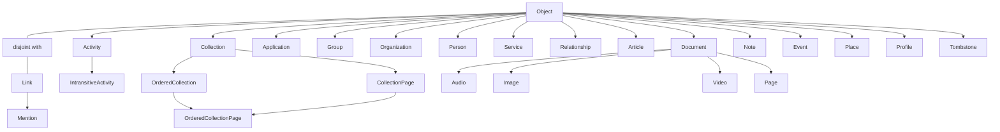

# ActivityStreams Vocabulary Registry

## Status

Design reference. This records the W3C ActivityStreams 2.0 Vocabulary as a
registry-shaped model for Axismundi. It does not introduce a runtime validator,
database schema, or a claim that the vocabulary is a closed JSON schema.

2026-10-28 결정 변경: 표준 AS2 Core/Extended 타입·속성의 의미 계약은 코어 어휘표가
완전하게 제공한다. 이전의 closed project subset 정책은 아래의
[Standard Baseline Decision](#standard-baseline-decision-2026-10-28)으로 대체한다.
이것은 구현 방향의 확정이며, 현재 데이터 파일·Activities 검증기·직렬화기가 이미 그 계약을
충족한다는 뜻은 아니다. 최초 결정 커밋 `772b3d9`는 문서만 수정했으며, 후속 표준 어휘표
구현 범위는 아래 Standard Baseline Implementation에 별도로 기록한다.

Source: [Activity Vocabulary](https://www.w3.org/TR/activitystreams-vocabulary/).
The specification defines vocabulary terms and inheritance, while ActivityPub
and individual FEPs define additional transport and interoperability contracts.

## Purpose

The registry is one shared description from which later work may derive:

- a protocol explorer and architecture graph;
- introspection of supported types and properties;
- projection capability declarations;
- query/index candidates; and
- opt-in validation profiles.

It is not the source of truth for a local WordPress object's ownership or
storage. A type may be projected from a post, a custom table, an Activity
ledger row, or a remote cache. A registry declaration says what an AS2 term
means, not where every product persists it.

## Registry Contract

Each type registration needs at least:

```text
term                 e.g. Question
iri                  https://www.w3.org/ns/activitystreams#Question
parent_terms         e.g. [IntransitiveActivity]
tier                 core | extended | custom
category             actor | activity | object | link | collection
provenance           as2-core | fep:<id> | product:<plugin>
projection_profiles  optional local source capabilities
declares_properties  property terms introduced at this type
excludes_properties  inherited terms not applicable at this type
status               standard | extension | deprecated
```

Each property registration needs at least:

```text
term                 e.g. inReplyTo
iri                  https://www.w3.org/ns/activitystreams#inReplyTo
spec_domain          exact RDF domain IRIs when the source declares them
spec_range           exact RDF range IRIs when the source declares them
rdf_functional       true | false | unspecified
value_shape          iri-or-object | link | string | timestamp | number | ...
runtime_cardinality  one | many | one-or-many | unspecified
jsonld_container     null | @list | @language | another declared JSON-LD container
semantic_family      identity | content | relation | addressing | ...
provenance           as2-core | fep:<id> | product:<plugin>
index_hint           none | scalar | relation | full-text | collection
source               versioned specification URI and term anchor
implementation_notes short Axismundi-only explanation, when needed
```

`spec_domain`, `spec_range`, and `rdf_functional` record the source ontology
without changing its meaning. In RDF, a domain or range is not a closed
allow-list for a JSON payload. The local fields describe a different layer:
wire representation, normalization, and storage. They may refine an otherwise
open representation, but they may never contradict the imported AS2 semantics.
For example, a functional RDF property has one semantic value per subject even
if the JSON reader accepts either a singleton or a one-element array. A local
cardinality rule that permits multiple distinct values in that case is an
implementation defect, not an alternate Axismundi policy. `value_shape`,
`runtime_cardinality`, and `index_hint` are therefore constrained Axismundi
metadata and must remain explicitly marked as such.

`value_shape` describes the value of the expanded RDF predicate. A JSON key's
container is a separate fact: `items` and `orderedItems`, for example, both
expand to `as:items` and carry the same member value shape, while only
`orderedItems` has the `@list` container required by Core section 4.6. Keeping
that fact in `jsonld_container` lets aliases share one predicate and shape
without making an unordered collection claim to be ordered.

`unspecified` is a real state, not a missing default. It says the snapshot has
recorded the term's wire shape but has not yet made a local runtime-cardinality
claim after protocol review. A loader must not turn that absence into
`one-or-many`: doing so makes an unresearched value look like a positive local
contract. A compact string entry in the JSON snapshot is precisely this
shape-only form; an object entry is used when a term needs an explicit IRI,
source, provenance, cardinality, or another non-default fact.

Extensions register new terms by IRI and provenance. They never overwrite the
meaning of an AS2 core term. An inbound payload can preserve unknown terms as
unmapped extensions; a future strict outbound profile can reject only the
terms that its selected profile does not permit.

## Normative Requirements Are A Third Registration

A type registration describes a term. A property registration describes a term.
Neither can hold "an actor has to have an `inbox`", because that is not a fact
about the `inbox` term -- it is a conformance rule bound to the Actor type by a
different specification. Recording normative requirements therefore needs its
own registration shape:

```text
subject            Actor | Activity | Object | Collection | a property | an endpoint
level              MUST | MUST NOT | SHOULD | SHOULD NOT | MAY
conformance_class  which class of software the source binds
source             specification URI + section anchor
kind               payload | behaviour
enforced_by        the command that fails when it is broken, or `convention`
```

`conformance_class` is not optional. A specification's MUST binds a class, and
a list that drops the class is how a client requirement gets enforced on a
server payload. `enforced_by` is not optional either, for the reason stated in
AGENTS.md: a rule without a named command is a convention, and recording one as
though it were enforced is worse than not recording it.

`kind` is what makes the register finite. Only a `payload` rule constrains the
content of a document, so only a `payload` rule can be checked by looking at
what we emit; a `behaviour` rule about delivery, retries or HTTP status codes
needs an integration test or nothing.

### Which specifications the requirements come from

Collected 2026-10-17 and measured rather than assumed:

| Source | What it contributes | Conformance classes |
| --- | --- | --- |
| Activity Streams 2.0 Core, W3C Recommendation 23 May 2017 | 71 requirements, 45 payload | conforming document, implementation, publisher, consumer (§9) |
| **ActivityPub, W3C Recommendation 23 January 2018** (`https://www.w3.org/TR/activitypub/`) | the normative source | conformant Client, Server, Federated Server |
| W3C Security Vocabulary / HTTP Signatures practice | `publicKey`, `publicKeyPem` | none; de-facto fediverse convention |

The ActivityPub row is a published Recommendation and the register anchors to
it. The collection that produced these counts -- 137 requirements, 40 of them
payload -- was taken from the **Editor's Draft** at
`https://w3c.github.io/activitypub/`, which carries errata the Recommendation
does not, so the two are not interchangeable. The draft is comparison material.
Every requirement promoted into the register is re-checked against the
Recommendation and anchored there, because a register whose job is to say where
a rule comes from cannot cite the wrong document.

One measured consequence of reading the Recommendation itself: the guidance that
a `Create`'s actor be copied onto the object's `attributedTo` is a **SHOULD**,
not a MUST. Attribution is therefore local policy resting on a recommendation,
which is worth knowing before building rules on top of it.

The third row is the finding worth keeping. **`publicKey` appears nowhere in
ActivityPub** -- zero occurrences in the fetched Editor's Draft, which handles
client keys through `provideClientKey` and `signClientKey` instead -- and it is
not an AS2 Vocabulary term either. Our Actor documents emit it because the
fediverse requires it in practice. A strict profile scoped to "AS2 plus
ActivityPub terms" would reject the one property without which no peer can
verify our signatures, so the registry carries a third provenance for de-facto
terms and does not pretend they have a normative home.

Two more scoping facts from the same collection. Of ActivityPub's requirements,
15 bind the **Client** class, which this project is not: a server must not
enforce them on itself. And both specifications write much of their security
and conformance prose in lower-case "should" and "must", which RFC 2119 does
not bind -- AS2 Core writes all of §9 that way, and ActivityPub's §9 contains
exactly one upper-case keyword. Those lines are recorded at the level the word
implies and marked, never cited as capitalised requirements.

### Five JSON keys are sourced somewhere other than the Vocabulary

A snapshot entry asserted `https://www.w3.org/ns/activitystreams#orderedItems`, an IRI that
does not exist, with a Vocabulary anchor that is a dead link. Chasing it produced a rule the
registry needs.

The Vocabulary's property section defines `items` and never defines `orderedItems`, and
`orderedItems` appears there only inside examples. That is not an omission. **Activity
Streams 2.0 Core section 4.6 is where it is stated**: in the JSON serialization a
Collection's unordered items use `items` while its ordered items use `orderedItems`. So it
is a property at the JSON level with a normative source -- just a different document from
the one our snapshot cited.

The normative context at `https://www.w3.org/ns/activitystreams` (148 terms, read
2026-10-17) shows the mechanism, and exactly five of its terms have an `@id` that is not
`as:<term>`:

```json
"orderedItems": { "@id": "as:items",    "@type": "@id", "@container": "@list" }
"nameMap":      { "@id": "as:name",                     "@container": "@language" }
"summaryMap":   { "@id": "as:summary",                  "@container": "@language" }
"contentMap":   { "@id": "as:content",                  "@container": "@language" }
"inbox":        { "@id": "ldp:inbox",   "@type": "@id" }
```

One RDF predicate, two JSON spellings, and the spelling carries the ordering or the
language mapping. The three `Map` keys have the same shape and their source is Core section
4.7, which is also where the two MUSTs about BCP 47 keys and string values live.

Two things follow for the registry, and the first is the reason this is recorded at all:

- **A term's `iri` is the predicate it expands to, not `as:` plus its own name.** For these
  five, deriving the IRI from the term produces a predicate nobody else uses, and a
  consumer expanding our document with it reads a different statement than the rest of the
  fediverse. Deriving a Vocabulary anchor from the term fails the same way, visibly, with a
  link that goes nowhere.
- **Their `source` is Core or the context, not the Vocabulary.** The register exists to say
  which document a fact comes from, so citing the wrong one is the failure it is meant to
  prevent.

`inbox` is a third case again. ActivityPub requires it on an actor and the context maps it
to `ldp:inbox`, so its vocabulary is the Linked Data Platform and neither of the two
specifications we collected owns it. It joins `publicKey` among terms whose provenance is a
document outside this pair.

The consequence for member order is narrow and benign: the renderer orders **JSON keys**, so
naming `name` and `nameMap` separately there is correct. The distinction matters where
properties are identified or counted.

### Findings that change rules we had already written

Five results from the same collection contradicted or re-sourced something this
project believed. They are kept because each one would otherwise be
re-discovered, and because three of them are about *which document* a rule comes
from, which is the mistake the `source` field exists to prevent.

| Finding | Why it matters here |
| --- | --- |
| `@context` is a **SHOULD**, not a MUST (Core §2.1 `#jsonld`), and §2.1.3 states the inverse MUST: a consumer receiving `application/activity+json` without a context reference has to assume the normative context anyway | Object Projections' rule that the renderer owns `@context` alone is **ours and stricter than the specification**. It must not be recorded as a specification requirement |
| `id` and `type` are **optional** in Core -- §4.1 says all Object properties are, "including the `id` and `type`" | "An object must have an `id`" is ActivityPub's requirement (§3.1 `#obj-id`), not AS2's. Our renderer rejecting an `id` that is not the declared object URI is a third thing again: our own invariant |
| The prohibition on HTML in `name` is a **MUST NOT**, and it is in the **Vocabulary**, not in Core | Core contains no such rule; its only markup rule is a SHOULD NOT on `summary`, and only when `name` is absent (§4.1.1). Stripping tags from `name` is therefore required of us, and the requirement's anchor is the Vocabulary's `name` definition |
| Core §5 is a **MUST**: a consumer meeting an unfamiliar extension property may not stop processing or signal an error, and continues as if it were absent. §5.2 adds SHOULDs to preserve extension properties and the original `@context` across re-serialisation | Preserving unknown FEP and vendor terms in the raw-extension path is **normative**, not a convenience we chose. It is also the reason registration buys normalisation and indexing rather than survival |
| An extension type that **overlaps** a core vocabulary type has to carry the core type too -- three parallel MUSTs, Core §4.1 (Object), §4.3 (Actor), §4.4 (Activity), with `gr:Location`/`Place` and `vcard:Individual`/`Person` as the examples | No current payload violates this: a FEP type such as `EmojiReact` overlaps no core type. It becomes live the moment an Actor is also typed through a foreign vocabulary, which the JSContact direction could reach |

One deliberate deviation belongs with them. Core §5 says to provide an
`@context` definition for every extension property emitted, and one of ours is
emitted as a fully expanded IRI key with no definition:
`http://fedibird.com/ns#emojiReactions`. That is intentional and the reason is
in the code (`axismundi-object-projections/includes/integrations/reactions.php`)
-- the full key is kept so a peer that does not compact the context term still
finds the property, and the scheme is `http` rather than `https` because in
JSON-LD the IRI *is* the property name, so the two spell different terms and the
FEP and its sibling namespaces write it the first way. The SHOULD is traded
away knowingly. It could also be satisfied without changing the emitted key, by
declaring an alias in the context while continuing to emit the expanded form,
since both compact to the same property; that is a small improvement and not a
correction.

### What is kept here, and what is not

AGENTS.md forbids keeping a copy of upstream current in this repository, and a
paraphrase of 208 normative sentences is exactly the kind of mirror that rule
is about: it would drift, and the drift would be invisible. So the register
holds only the requirements this project has chosen to check, each pointing at
its specification anchor -- a list of our checks, not a copy of the specs. The
full collection stays working material.

### Seeds: what is already enforced

Three rules of this shape are already in force, and naming them is what turns
the register into a difference rather than an inventory:

| Requirement | Where | Enforced by |
| --- | --- | --- |
| An object's `id` equals the object URI its transformer declared | Object Projections SPEC.md section 4.1 | the renderer rejects a mismatch |
| `@context` is assembled in one place; a transformer supplying one has it stripped | SPEC.md section 4.2 | the renderer |
| An Actor without a key fails closed, inbox and key written atomically | ActivityPub Bridge | its own audit |

And one honest qualification measured the same day: the ActivityPub MUSTs that
an actor object carry `inbox` and `outbox` do hold in our output, and a
regression would be caught -- but only incidentally, by a composite condition
inside `audit-actor-projection.php` whose subject is transport-field override.
A requirement enforced as a side effect of another test is the case
`enforced_by` exists to make visible.

## Registry Serialization

The machine-readable source should be a checked-in, versioned JSON registry;
Markdown is the design explanation and a future rendered view. The runtime
must not scrape the W3C document or resolve arbitrary vocabulary URLs on a
request path. A registry snapshot records the source version and preserves
the distinction between specification facts and Axismundi decisions:

```json
{
  "iri": "https://www.w3.org/ns/activitystreams#property-name",
  "term": "property-name",
  "provenance": "as2-core",
  "source": {
    "specification": "https://www.w3.org/TR/activitystreams-vocabulary/",
    "anchor": "#property-name"
  },
  "rdf": {
    "domain": ["source-declared IRI"],
    "range": ["source-declared IRI"],
    "functional": "unspecified"
  },
  "axismundi": {
    "value_shape": "declared after protocol review",
    "runtime_cardinality": "one-or-many",
    "storage_route": "scalar | relation | ordered-members | raw-extension"
  },
  "implementation_notes": "Optional, short, and not an enforcement rule."
}
```

Use `null` or an empty list only to mean that the imported source does not
declare a value; never infer an absent RDF declaration as a closed rule. A
separate authoring profile may declare which types and values Axismundi emits.
Inbound federation remains permissive: known fields are normalized, while
unknown FEP or vendor fields survive in the raw-extension path.

Do not import the Vocabulary's prose wholesale as `notes`. Keep the stable
source URL and anchor for every term, then add `implementation_notes` only
where a local decision needs explanation, such as the distinction between
`inReplyTo` and a WordPress parent, or between `oneOf` and poll storage.

## Standard Baseline Decision, 2026-10-28

이전의 **closed project subset** 정책을 폐기한다. AS2 Vocabulary §2 Core Types와
§3 Extended Types 전체 및 그 속성 계약을 OP의 코어 데이터에 내장한다. 구현 제품에서
당장 사용하는 타입만 골라 넣지 않는다. 표준 타입을 안다는 것과 그 행위의 효과·저장·UI를
구현했다는 것은 별개이다.

근거는 [AS2 Vocabulary](https://www.w3.org/TR/activitystreams-vocabulary/#types)와
[AS2 Core 모델](https://www.w3.org/TR/activitystreams-core/#model)이다. 2017 W3C
Recommendation의 유한한 타입·속성 정의를 버전이 명확한 의미 데이터로 보관하는 것은,
상류의 설명문·예제·규범 문장 전체를 복제하는 것과 다르다. 위의 prose/notes 비복제 원칙은
유지한다. 요청 중 W3C 문서를 fetch하거나 임의의 Context를 실행하지 않는다.

결정 당시 `data/activitystreams-vocabulary.json`은 타입 20개·속성 63개였다. Core 8종은 모두
있고, 빠진 타입은 Extended 쪽이다. category 분포는 object 11, link 2, activity 3,
collection 4이며 actor는 0이다. 이것은 변경 전 실측이지 새로운 완료 기준의 충족 증거가 아니다.
Actor 5종과 구체 Activity 다수를 포함한 전체 표준 대조는 구현 단계에서 수행한다.

### Orthogonal Type Axes

`tier`와 `category`를 분리한다. `tier`는 AS2 표준 내 계층 또는 외부 확장 여부,
`category`는 엔티티의 종류다. provenance·정확한 IRI·근거 문서는 별도로 유지하며,
IRI의 네임스페이스가 같다는 이유로 표준성과 출처가 같다고 추론하지 않는다.

| 타입 | tier | category | 부모 |
|---|---|---|---|
| Object | core | object | 없음 |
| Activity | core | activity | Object |
| IntransitiveActivity | core | activity | Activity |
| Person | extended | actor | Object |
| Create | extended | activity | Activity |
| Arrive / Travel | extended | activity | IntransitiveActivity |
| Question | extended | activity | IntransitiveActivity |
| EmojiReact | custom | activity | 확장 근거를 확인해 등록 |

Core 8종은 Object, Link, Activity, IntransitiveActivity, Collection, OrderedCollection,
CollectionPage, OrderedCollectionPage다. Extended도 표준이며 custom과 혼동하지 않는다.
기존 category에 core를 섞었던 계약은 이 두 축으로 대체한다. 이 문서 변경만으로 런타임의
`tier` 검증이 추가되지는 않는다.

### Closure, Aliases, and Extension Ownership

closure 규칙은 유지한다. 타입이 `declares`/`excludes`로 참조하는 속성이 의미 표에 없으면
현재 로더는 거부한다. 표준 타입 추가 시 필요한 속성 정의를 함께 대조해야 한다. 다만 RDF
domain/range를 폐쇄형 JSON schema로 해석하거나 선언된 모든 속성을 필수로 만들지 않는다.

`nameMap`·`summaryMap`·`contentMap`은 표준 Context가 각각 name·summary·content와
같은 IRI에 `@language` 컨테이너를 부여한 별칭이다. 독립 의미 속성으로 중복 추가하지 않는다.
감사는 JSON 키의 수동 목록 포함 여부가 아니라, 표준 Context의 별칭·컨테이너와 등록된
IRI·출처를 구분해야 한다. 의미 표에 항목이 없다는 것만으로 직렬화 미지원이나 잘못된 JSON으로
판정하지 않는다. AP의 추가 속성 역시 AS2 본문 속성과 출처를 구분한다.

custom 용어는 코어 표준 파일에 넣지 않는다. 구현 플러그인이 런타임에 의미·Context 계약을
등록하고, 등록된 네임스페이스와 정확한 IRI·FEP/vendor 근거를 연결한다. 새 prefix를 발명하거나
기존 IRI를 바꾸라는 뜻은 아니다. 등록은 해석·검증·색인 권한을 주며, 미등록 확장의 보존을
금지하는 수단은 아니다. 입출력의 보안·공개 정책은 계속 적용한다.

| 용어 | 소유와 후속 계약 |
|---|---|
| Emoji | Emoji 플러그인. `includes/outbound.php`의 FEP-9098 조건부 타입/Context 선언을 유지하고 의미 등록과 정합성을 맞춘다 |
| EmojiReact | Activities 플러그인. FEP-c0e0 근거로 런타임 등록하고 자체 문자열 허용 목록 의존을 제거한다 |
| sensitive / manuallyApprovesFollowers | 객체 일반 속성이므로 OP의 기존 SWICG Miscellaneous Terms 등록·조건부 Context 선언을 유지한다 |
| Hashtag | 타입으로 등록하지 않는 기존 제품 결정을 유지한다. tag 항목의 name 접두사로 판별한다 |

참조: [FEP-9098](https://codeberg.org/fediverse/fep/src/branch/main/fep/9098/fep-9098.md),
[FEP-c0e0](https://codeberg.org/fediverse/fep/src/branch/main/fep/c0e0/fep-c0e0.md),
[SWICG sensitive](https://www.w3.org/community/reports/socialcg/CG-FINAL-apmisc-20260828/#sensitive),
[Hashtag 결정](activitystreams-object-contract.md#hashtag-is-not-a-registered-type-2026-10-20).

현재 Emoji는 Context 선언 API에 등록되지만, 이것만으로 모든 의미 메타데이터와 assembler
연결이 완성됐다고 보지는 않는다. EmojiReact는 Activities의 자체 허용 목록과 출력 코드에
있으며 OP 의미 등록은 없다. 기존 QuoteRequest 등 확장 선언도 있으므로 "현재 custom 타입
등록이 0개"라고 기록하지 않는다. 플러그인 비활성화가 과거 원장 payload·Context를 지우거나
재해석하는 근거가 되어서는 안 된다.

### Contract Mismatch and Implementation Order

핵심 불일치는 OP의 Question → IntransitiveActivity → `object` 제외 계약과,
Activities의 자체 타입 목록 + 전 타입 `object` URI 필수 검사가 연결되지 않았다는 점이다.
후자는 독립 Question을 받지 못한다. 현재 Create(Question) 처리 경로가 존재한다는 사실은
독립 Question Activity의 지원과 다르다. 타입 이름을 추가하는 것만으로 이 불일치는 해결되지 않는다.

1. 코어 파일의 AS2 표준 타입·속성 계약을 완성한다. closure, 상속, 별칭과 출처를 감사한다.
2. Activities의 병렬 타입 허용 목록을 공통 어휘 계약 참조로 대체한다. 같은 단계에서
   EmojiReact의 Activities 소유 런타임 등록을 연결한다. 기록 가능한 문서와 실행 가능한
   행위의 범위를 분리하고, 인증·인가를 느슨하게 만들지 않는다.
3. Actor·Activity 소스 어댑터가 공통 계약과 assembler를 거치게 한다. 하나의 AP 응답 엔진을
   사용하고 어댑터별 독립 직렬화 규칙을 줄인다. 어댑터는 소스 읽기 책임이며, 단순 타입 이름
   삽입만으로 계약을 충족했다고 보지 않는다. `object-assembly.php`의 ancestor 선택은 이미
   어휘 기반이다. 알려진 표준 타입 누락을 unknown Object fallback이 숨기지 않게 검증한다.
4. `direction='local'`을 정리한다. 발신/수신과 로컬 전달 방식을 분리하고, 기존 행의 URI·payload를
   보존한다. 이행 때문에 과거 Activity를 재발신하거나 공개 범위를 넓히지 않는다.
5. 내장 객체·복수 값 보존과 소스 중립 제출을 연결한 뒤 C2S outbox POST를 구현한다.
   Note/CPT 컷오프나 별도 전용 REST API보다 이 공통 계약 정비가 선행한다.

실행 결과만으로 계약 충족을 주장하지 않는다. 표준 예제, 기존 기록과 공개 URL 보존,
등록/직렬화 불일치를 잡는 변이 검증을 구현 단계의 완료선으로 삼는다. 기존 감사가 소수 타입만
다뤘다는 한계와 inbox 고아 멤버십 정합성 문제도 별도로 확인한다. 이번 커밋은 이 계획을
기록할 뿐 데이터·런타임·엔드포인트를 변경하지 않는다.

## C2S Processing and Storage Boundary, 2026-10-28

저장 책임은 엔티티별로 분리한다. Actors는 Actor 원본·신원·수명, Activities는 inbound와
outbound Activity 원장 및 행위별 상태를 소유한다. OP는 Object의 투영·읽기 표현과 객체
저장소 연결을 소유하며 WP 객체는 `wp_posts`, 원격 관찰은 remote Object cache, 신규 로컬
객체는 local Object 저장소로 분리한다. 이것은 목표 경계이며 이번 단계에서 신규 local
Object 테이블이나 마이그레이션을 만들지는 않는다. 어휘표가 공통이라고 DB identity의
부모를 다시 하나로 합치지 않는다. Question 저장 소유는 Activities라는 기존 결정을 유지한다.

AP C2S 처리기는 §6의 타입별 서버 동작을 해석한다. 저장·효과·전달을 어휘 등록 자체의
부작용으로 만들지 않는다. 제출 Actor 권한 및 transport 인증도 별도로 검증한다.

| 제출 | 처리 계약 |
|---|---|
| 비-Activity Object | §6.2.1에 따라 Create의 object로 감싸고, 비-transient 객체와 Create 각각에 서버 ID를 부여한다. 지정된 addressing을 Create에 복사한다 |
| Create(Object) | §6.2에 따라 객체를 생성하며 귀속·수신 범위의 정합성을 처리한다. Object 저장과 Activity 확정은 별개의 책임이지만 하나의 일관된 로컬 커밋 경계로 연결한다 |
| Like | Activity를 기록하고 §6.8의 liked 컬렉션 효과를 행위 처리기로 적용한다. Object 본문을 새로 생성하지 않는다 |
| Undo | §6.10에 따라 원 Activity와 Actor 동일성을 검사하고, 가능한 효과를 되돌린다. 대상 원장 payload를 삭제·재작성하지 않는다. Create/삭제 및 컬렉션 제거는 Delete/Remove 계약과 구분한다 |
| Update / Delete | 객체 소유 저장소의 수정·철회와 원장 기록을 연결한다. C2S 부분 수정 및 삭제 응답 계약은 해당 AP 절에서 검증한다 |
| 독립 Question | AS2 §5.4의 IntransitiveActivity로 원장에 직접 기록한다. object 없이 수용하고 동일 Actor의 Undo 대상이 된다. 자동으로 Create로 감싸거나 poll DB에 넣지 않는다 |
| Create(Question) | Create는 원장에 기록하고 내장 Question은 Activities의 Question DB에 투영한다. FEP-9967 poll 경로이며 Question 자체를 별도 원장 사건으로 중복 생성하지 않는다 |

직접 Activity 제출과 Object 제출을 같은 분기로 취급하지 않는다. Question 예외도 전송
프로필의 규칙이지 AS2 상속 트리나 저장 소유를 바꾸는 규칙이 아니다. 로컬 커밋 후 확정된
동일 Activity를 수신자에게 전달하며, S2S 전달용 Create를 한 번 더 생성하지 않는다.

근거: [AP §6](https://www.w3.org/TR/activitypub/#client-to-server-interactions),
[§6.2.1](https://www.w3.org/TR/activitypub/#object-creation-without-a-create-activity),
[FEP-9967](https://codeberg.org/fediverse/fep/src/branch/main/fep/9967/fep-9967.md).

## Standard Baseline Implementation, 2026-10-28

코어 어휘 데이터에 AS2 타입 54종을 등록했다. Core 8종과 Extended 46종을 `tier`로
구분하고, Actor 5종을 포함해 category와 부모를 명시한다. Invite → Offer,
TentativeAccept → Accept, TentativeReject → Reject, Block → Ignore 등 직접 상속을
보존한다. 표준 타입 등록은 해당 Activity의 서버 효과나 C2S 처리 완료를 의미하지 않는다.

W3C Vocabulary 원문의 §4 속성은 62개이며 기존 표가 이미 모두 포함하고 있었다.
`orderedItems`는 별도 술어가 아니라 Core의 items/@list 별칭이므로 등록 수는 63개를
유지한다. nameMap 등 언어맵을 새 속성으로 중복 추가하지 않았다. image·object·relationship
속성의 출처 앵커는 같은 이름의 타입 앵커와 구분해 정정했다.

원문 HTML의 타입·직접 부모·Core/Extended 구분과 속성 목록을 현재 데이터와 직접 비교했다.
`tests/audit-standard-vocabulary.php`는 고정된 표준 목록, closure, 상속, IRI, 별칭 경계와
확장 분리를 오프라인으로 재검사한다. `tests/audit-standard-vocabulary-mutations.php`는
메모리 내 누락·부모 변경·exclusion 제거·속성 누락으로 이 감사가 실패하는지 확인한다.
명령은 OP 경로의 각 파일에 대한 `wp eval-file`이며 변이는 `AX_STANDARD_VOCAB_MUTATION`에
`type`, `parent`, `exclusion`, `property` 중 하나를 지정한다. 요청 시 원문 fetch는 추가하지 않았다.
실측 결과: 표준 어휘 감사 239개, 기존 어휘 감사 15개, Context 감사 43개, transformer
레지스트리 감사 4개 통과. 네 변이는 각각 의도한 단언에서 CAUGHT였고 PHP lint 및
`git diff --check`도 통과했다. HTTP C2S 또는 전체 행위 효과의 준수 검증을 뜻하지 않는다.

이 표준 어휘 기반 단계 직후 Activities 계약 연결을 아래와 같이 구현했다.
어댑터/assembler 전체 연결, direction local 이행, C2S outbox POST, 신규 로컬 Object
저장소는 여전히 후속 단계다.

## Activity Ledger Vocabulary Admission, 2026-10-28

Activities의 22종 하드코딩 목록을 제거했다. OP의 표준·런타임 의미 타입을 열거하고
Activity 상속 여부로 원장 수용 후보를 만든다. 기존 `axismundi_act_types` 필터는 후보를
제한할 수 있지만 의미 등록 없이 타입을 추가할 수 없다. 따라서 OP는 이제 Activities의
명시적인 필수 의존성이다. OP가 없으면 옛 목록으로 폴백하지 않는다.

object 허용 여부는 OP의 effective properties에서 읽는다. IntransitiveActivity 하위는
object 없이 저장되며 object를 넣으면 거부한다. 그 외 타입의 기존 object URI 요구와
Add/Remove/Move의 target, QuoteRequest의 instrument 요구는 유지한다. 이 단계는 AS2의
모든 선택 속성을 곧바로 완전 수용하거나 모든 행위 효과를 실행한다는 주장이 아니다.
확장 타입 이름은 기존 varchar(32)에 맞지 않으면 저장 전에 거부한다. 스키마는 변경하지 않았다.

`includes/vocabulary.php`에서 Activities가 EmojiReact(FEP-c0e0, Like 상속)와
QuoteRequest(FEP-044f, Activity 상속)의 의미 타입 및 조건부 Context를 함께 등록한다.
QuoteRequest Context의 기존 범위와 바이트를 유지하면서 OP의 중복 선언을 제거했다.
EmojiReact의 IRI는 FEP가 지정한 `http://litepub.social/ns#EmojiReact`를 사용한다.
등록 실패 후 재시도에 부분적인 타입이 남지 않도록 OP 로더의 rollback 대상에 의미 등록도 포함한다.

독립 Question과 Create(Question)의 저장 경로는 위 표대로 분리한다. 기존 poll 투영기는
Create/Update의 내장 Question만 처리하므로 독립 Question의 payload나 Undo를 poll 집계에
강제로 적용하지 않는다. Undo는 기존 원장의 동일 Actor 검증·effective 상태 전이를 재사용한다.

검증 명령:

```sh
wp eval-file wp-content/plugins/axismundi-activities/tests/audit-vocabulary-contract.php
wp eval-file wp-content/plugins/axismundi-activities/tests/audit-vocabulary-contract-mutations.php
wp eval-file wp-content/plugins/axismundi-actors/tests/audit-principal-fixture-cleanup.php
```

계약 감사는 26개 단언으로 Arrive/Travel/Question의 object 없는 기록, 제외 속성 거부,
동적 확장 등록, 두 Question 저장 경로, 동일/상이 Actor Undo, 기존 원장·Question·principal
행 내용 보존을 검사한다. 변이는 타입 누락, IntransitiveActivity exclusion 제거,
Question의 부모를 Activity로 바꾸기를 각기 별도 프로세스에서 적용한다. 소스 파일이나
기존 DB 행을 변이하지 않는다. 복수 값 인덱싱, local→outbound 이행, 내장 객체 ID 발급은
이 작업에 포함하지 않는다.

실측: 계약 감사 26, repository 21, poll 16, emoji reactions 39, QuoteRequest 11,
public outbox 4, Actor feed 85, Context 43개 단언 통과. 세 변이는 각각 의도한 실패를
검출했고 principal 반복 회귀는 12개 감사 × 2회 = 24/24 통과했다. PHP lint와
`git diff --check`도 통과했다. 인용 픽스처는 축 마이그레이션 후 계약에 맞게 명시적
Create를 기록하도록, 피드 픽스처는 예약 작업을 검사하는 구간만 자기 opt-in을 주입하도록
보완했다. 두 감사의 principal 정리 누락도 수정했다.

감사 위생의 잔여 한계: 기존 반복 묶음의 Forum/축 관련 실행에서 원장 90행 및 관계 20행이
남았다. principal 감사 통과는 원장·관계 보존의 증명이 아니다. 이번 실행의 시각·행 ID와
이미 삭제된 픽스처 Actor를 대조해 해당 실행분만 제거했다. 원장 ID 범위는
92716–92756, 92779–92782, 92809–92849, 92872–92875였고, 별도로 이번 실행에서
생긴 principal (54770, wp_user 54626), (54775, wp_user 54629)도 정확히 제거했다.
최종 원장 30,770행·principal 1,038행으로 복구했다. 전체 감사의 원장·관계 누수 방지는
별도 후속 과제이며, 이번 신규 계약 감사는 자기 실행 전후 원장 전체 행 내용을 비교한다.

## Type Hierarchy

`Object` and `Link` are disjoint core types. An Activity is an Object; an
IntransitiveActivity is an Activity whose inherited `object` property does not
apply. `OrderedCollectionPage` has two parents.



The standard extended Activity tree is separate because it is large and
should not be confused with local source types:

```text
Activity
|- Accept
|  `- TentativeAccept
|- Add
|- Announce
|- Create
|- Delete
|- Dislike
|- Flag
|- Follow
|- Ignore
|  `- Block
|- Join
|- Leave
|- Like
|- Listen
|- Move
|- Offer
|  `- Invite
|- Read
|- Reject
|  `- TentativeReject
|- Remove
|- Undo
|- Update
`- View

IntransitiveActivity
|- Arrive
|- Question
`- Travel
```

Notes for local architecture:

- `Question` is an `IntransitiveActivity`, but can still be a durable,
  post-backed local source and can be embedded in a `Create` Activity.
- `Like`, `Announce`, `Follow`, and similar event-first types can be authored
  directly into the Activity ledger without a WordPress post source.
- `Article`, `Note`, `Event`, and `Place` do not prescribe a CPT. A product
  selects a source and registers an explicit projection profile.
- `Document` is the parent of `Audio`, `Image`, `Video`, and `Page`. For a
  WordPress attachment, MIME type is a local discriminator for one of those
  projections; it is not an AS2 inheritance rule.

## Effective Property Sets

A type's effective core-property set is the union of its direct parent's
effective set and its own declarations, less explicit exclusions. This gives
the registry a useful internal conformance contract without claiming that
ActivityStreams forbids every extension property not named below.

```text
effective_properties(type) =
  union(effective_properties(parent))
  + declares_properties(type)
  - excludes_properties(type)
```

The core declarations to seed that contract are:

```text
Object
  attachment, attributedTo, audience, content, context, name, endTime,
  generator, icon, image, inReplyTo, location, preview, published, replies,
  startTime, summary, tag, updated, url, to, bto, cc, bcc, mediaType, duration

Activity (inherits Object)
  actor, object, target, result, origin, instrument

IntransitiveActivity (inherits Activity)
  excludes object

Question (inherits IntransitiveActivity)
  oneOf, anyOf, closed

Collection (inherits Object)
  totalItems, current, first, last, items
OrderedCollection (inherits Collection)
  orderedItems
CollectionPage (inherits Collection)
  partOf, next, prev
OrderedCollectionPage (inherits OrderedCollection and CollectionPage)
  startIndex

Relationship (inherits Object)
  subject, object, relationship
Place (inherits Object)
  accuracy, altitude, latitude, longitude, radius, units
Profile (inherits Object)
  describes
Tombstone (inherits Object)
  formerType, deleted

Link
  href, rel, mediaType, name, hreflang, height, width, preview
Mention (inherits Link)
```

`Application`, `Group`, `Organization`, `Person`, `Service`, `Article`,
`Document`, `Audio`, `Image`, `Video`, `Page`, `Note`, and `Event` inherit
their listed parent's core properties without a further core declaration here.
`Accept`, `Add`, `Create`, and the other concrete Activity terms likewise
inherit Activity's set unless an extension profile declares more.

### Worked Expansion: Question

The durable Question ledger takes its columns from this set rather than from
improvisation, so the expansion is written out once, with the storage route
each property takes.

```text
effective_properties(Question) =
  Object's set + { actor, target, result, origin, instrument } + { oneOf, anyOf, closed }
  - object
```

```text
scalar on the row        content, contentMap, name, nameMap, summary, summaryMap,
                         published, updated, startTime, endTime, duration,
                         mediaType, url, closed
relation occurrence      attachment, attributedTo, actor, audience, context,
                         icon, image, inReplyTo, location, preview, tag,
                         target, result, origin, instrument
addressing snapshot      to, cc, bto, bcc
ordered members          oneOf, anyOf
derived collection       replies
identity, not a column   id and type: id is the identity row, type is a
                         rebuildable projection the owning source declares
raw payload              every unregistered extension received
```

Five things this expansion settles that a column list would have guessed at.

- `oneOf` and `anyOf` are not two stores. They are one ordered option set plus
  a selection mode; the emitted key follows the mode, and the rows do not move
  when it changes.
- `closed` is not a datetime column. AS2 allows a timestamp, a boolean, or an
  Object, so a lone datetime cannot express "closed, time unknown". The row
  needs the flag and the time separately.
- `actor` and `attributedTo` both survive the expansion, and both are real.
  A Question is an Activity, so `actor` is its performer; the fediverse writes
  polls with `attributedTo` and that is what interoperates. Keep both: emit for
  compatibility, retain what was received.
- `replies` and the tally read the same edges. A vote is a `Create(Note)` whose
  `inReplyTo` is the Question, so a naive reply count counts votes. The
  classifier that already separates them -- empty content, exact frozen option
  name -- is what the collection must consult, not the edge table alone.
- A content warning is `summary` with the `sensitive` extension, so it travels
  with `content` for retention. `sensitive` is not core AS2 and is registered
  as an extension with its own provenance, not quietly treated as a core term.

### Validation And Storage Are Different Questions

This property contract can constrain an authored write without turning every
property into an undifferentiated key/value row. A future property writer first
calculates the effective set for the resource type, then routes a registered
property by its `value_shape` and `index_hint`:

| Value family | Durable projection | Example |
| --- | --- | --- |
| scalar or language-map property | typed property row or a source-specific scalar projection | `name`, `content`, `closed` |
| Object/Link/IRI relation | relation occurrence with target resource or URI and Link descriptor | `attachment`, `tag`, `inReplyTo` |
| ordered member | membership/options table with stable member identity and position | `orderedItems`, `oneOf` |
| addressing snapshot | Activity ledger or audience relation projection | `to`, `cc`, `audience` |

The proposed property layer is therefore an enforcement and typed-projection
boundary, not an instruction to put relation lists, poll options, or raw remote
JSON into one `objectmeta` EAV table. Local authored writes can be strict:
reject an unregistered property or one excluded by the selected type. Inbound
payloads remain permissive: preserve unknown or unregistered FEP/vendor fields
in the raw representation, and project them only after a provenance-bearing
extension registration exists.

### One Vocabulary Authority, Several Value Authorities

The type hierarchy, property definitions, inheritance/exclusion rules, value
shapes, and extension provenance have one authority: the vocabulary registry.
The value of a property does not. It remains owned by the aggregate whose
lifecycle made it true:

| Aggregate | Property-value authority | Examples |
| --- | --- | --- |
| Actor | Actors identity/profile source and its typed projections | `name`, `icon`, `inbox`, public-key material |
| Object | local post/native source or remote Object cache, plus Object relation projections | `content`, `attributedTo`, `attachment`, `inReplyTo` |
| Activity | immutable Activity ledger payload and ledger columns | `actor`, `object`, `target`, `to`, `published` |
| Collection | collection/membership source and ordered-member projection | `items`, `orderedItems`, `totalItems` |

Consequently, do not create one authoritative `actor_meta | object_meta |
activity_meta | collection_meta` replacement table. That would duplicate
different revision, retention, and mutability rules under a uniform key/value
shape. Instead, the registry supplies a property binding: for a resource kind,
source kind, and registered property, it selects the validator and the owning
writer/reader. A future cross-resource `property_values` table may exist as a
rebuildable typed index for a named query or a registered extension, carrying
owner kind/ID, property IRI, representation revision, and provenance. It is
not the authority for Core post fields, Actor profiles, immutable Activities,
or collection membership.

## Core Property Registry

The following table covers the core Vocabulary property names. “Primary
semantic use” is a registry aid, not an exclusive allowed-type list: the AS2
vocabulary deliberately permits extension and composition.

| Property | Value shape | Primary semantic use | Index hint |
| --- | --- | --- | --- |
| `id` | IRI | canonical identity | scalar unique |
| `type` | term or term list | type membership | scalar/type set |
| `mediaType` | media type | representation | scalar |
| `url` | IRI, Link, or list | human/machine representation | relation |
| `name`, `nameMap` | string, language map | display name | full-text |
| `summary`, `summaryMap` | string, language map | summary | full-text |
| `content`, `contentMap` | string, language map | authored body | full-text |
| `published`, `updated` | timestamp | resource time | scalar |
| `attachment` | Object or Link list | attached resources | relation |
| `attributedTo` | Object or Link list | authorship attribution | relation |
| `audience` | Object or Link list | addressed audience context | relation |
| `context` | Object or Link | shared conversation/context | relation |
| `generator` | Object or Link | generating application/service | relation |
| `icon`, `image` | Object or Link | visual representation | relation |
| `inReplyTo` | Object or Link list | direct reply parent | relation |
| `location` | Object or Link | place/location | relation |
| `preview` | Object or Link | preview resource | relation |
| `replies` | Collection | replies collection | relation |
| `tag` | Object or Link list | tags, mentions, hashtags | relation |
| `to`, `cc`, `bto`, `bcc` | Object or Link list | delivery addressing | relation |
| `actor` | Object or Link | Activity performer | relation |
| `object` | Object, Link, or IRI | Activity direct object | relation |
| `target` | Object, Link, or IRI | Activity target/context | relation |
| `result` | Object, Link, or IRI | Activity result | relation |
| `origin` | Object, Link, or IRI | Activity origin | relation |
| `instrument` | Object or Link | instrument used for Activity | relation |
| `items` | Object or Link list | Collection members | collection |
| `orderedItems` | Object or Link list | ordered Collection members | collection |
| `current`, `first`, `last`, `next`, `prev`, `partOf` | CollectionPage or Link | collection navigation/membership | relation |
| `totalItems`, `startIndex` | integer | collection cardinality/offset | scalar |
| `oneOf`, `anyOf`, `closed` | Object/Link list, timestamp | Question options and closure | relation/scalar |
| `accuracy`, `altitude`, `latitude`, `longitude`, `radius`, `units` | number or string | Place geometry | scalar |
| `duration`, `startTime`, `endTime` | duration or timestamp | temporal extent | scalar |
| `height`, `width` | integer | Link/media dimensions | scalar |
| `href`, `hreflang`, `rel` | IRI or string | Link target and relation | scalar |
| `subject`, `relationship` | Object, Link, or IRI | Relationship endpoints/type | relation |
| `describes` | Object or Link | Profile subject | relation |
| `formerType`, `deleted` | term, timestamp | Tombstone history | scalar |

## Property Families and Local Boundaries

The property registry should guide storage choice without forcing all values
into post meta.

| Family | Examples | Default durable form |
| --- | --- | --- |
| Identity and lifecycle | `id`, `type`, `published`, `updated`, `deleted` | source row plus object/activity registry |
| Local scalar authoring settings | visibility policy, language choice, content warning | source-specific settings or registered post meta |
| Object relations | `inReplyTo`, `attachment`, `tag`, `attributedTo`, `context` | URI-keyed relation table; not duplicated as authoritative post meta |
| Addressing/delivery snapshot | `to`, `cc`, `bto`, `bcc`, `audience` | Activity ledger snapshot; source stores editable intent only |
| Ordered structured members | Question options, collection items | domain table with order and stable member identity |
| Remote/unmapped extensions | FEP or instance fields | preserved raw payload plus extension registry/projection |

This keeps WordPress post meta useful for local editor-facing scalar settings
without pretending that a key/value store can provide a durable graph,
collection ordering, or Activity delivery history.

## Projection Profiles Are Separate From Type Terms

A projection profile connects a local source to an AS2 type. It does not alter
the type hierarchy. Initial examples:

| Local source | Profile result | Selection rule | Status |
| --- | --- | --- | --- |
| core `post` | `Article` | explicit core post profile | proposed |
| core `attachment` | `Image`, `Audio`, `Video`, or `Document` | `post_mime_type` | proposed |
| `ax_note` | `Note` | no Quote form | existing domain behavior |
| `ax_note` + Question rows | `Question` | structured poll definition | **legacy during cutover** -- superseded |
| Activities Question ledger | `Question` | a Question identity in that ledger | target model |
| Calendar source | `Event` | Calendar-owned profile | existing product direction |
| core `page` | no default | explicit opt-in only | proposed |
| Activity ledger row | Activity subtype | direct Activity authoring | proposed |

### A term's absence from the snapshot is not the same gap as nothing projecting it

Reviewing the first registry slice conflated the two, so the distinction is
recorded. A vocabulary snapshot carries **vocabulary facts**: `Note`, `Place`,
`Mention` and `Tombstone` are AS2 terms with `as2-core` provenance and belong in
it whoever projects them, or nobody does. Which product projects a type, and how
mature that projection is, is a separate question with separate answers:

| Type | Projection owner | State, 2026-10-17 |
| --- | --- | --- |
| `Article`, `Image` / `Audio` / `Video` / `Document` | Object Projections, from core `post` and `attachment` | implemented; these are what a later slice needs the registry to answer for |
| `Note` | the Note plugin | implemented there, not here |
| `Place` | the Geodata plugin | not implemented |
| `Mention` | Object Projections, inline today | its parent is `Link`, so the Link model handler may replace the current implementation rather than adopt it |
| `Tombstone` | Object Projections | **logically incomplete**, see below |

So "the registry answers nothing for `Note`" is not a defect in the Note plugin,
and "nothing projects `Place`" is not a defect in the registry. What a later
slice is actually blocked on is narrower than the list of absent terms: the types
this plugin itself projects.

`Tombstone` deserves its own note because the incompleteness is measurable
rather than aesthetic. `formerType` has exactly two sources today: the
`object_type` recorded in the remote object cache, which exists only for a remote
object we had already cached, and one hardcoded `QuoteAuthorization`. **A local
object's former type has no source at all**, because nothing records what type a
local object was before it was deleted -- which is precisely what a shared object
registry records. Until it does, a local Tombstone cannot state what it replaced,
and the current implementation should be read as a placeholder rather than as the
model.

`post_status = publish` is a visibility/lifecycle condition, never a sufficient
projection selection rule. A published template, navigation item, or site page
is not automatically federated content.

## Where The Registry Lives, And What Stays With Each Product

Decided 2026-10-17. The registry is held by Axismundi Object Projections, and
it is held there because that plugin owns the representation this vocabulary
describes -- not because it is the registry's only reader. An earlier draft of
this section said the latter, and it was already false when written: a plugin
that reads `effective_properties()` to build an editor control, a post-meta
binding or a custom-table column is a reader too, which is most of them. What
follows from several readers is not a different location but a requirement --
the registry is published through a **read API with a stable contract**, and no
reader may reach into its storage. Ownership follows who maintains the
vocabulary facts and serves them; a local Actor is a local Object:
Object Projections already assembles the Actor document
(`includes/integrations/actors.php`), and Axismundi Actors contains no AS2
assembly at all -- not one `@context` -- so "the projector lives here" is the
measured present state rather than a proposal.

An earlier objection, that Actors and Activities must be able to answer type
questions without the representation plugin, was about a consumer that does not
exist. Measured the same day: no plugin references `IntransitiveActivity`
anywhere, so the type hierarchy exists only in this document. What those
plugins do carry is a different thing, and it stays with them:

| Kind of fact | Example | Owner |
| --- | --- | --- |
| Vocabulary fact | `Question` inherits `IntransitiveActivity`, which excludes `object` | the registry, in Object Projections |
| Product support list | the 22 Activity types this instance accepts (`axismundi-activities/includes/repository.php`), the five Actor types (`axismundi-actors/includes/repository.php`) | each plugin |

A support list says what a product authors or accepts; it is not a claim about
what the vocabulary contains. Keeping them apart is what lets every plugin keep
working with Object Projections absent -- only assembling a document needs the
registry.

What the registry supplies is **vocabulary classification** -- which terms
exist, what their parents are, which properties a type has, what shape a value
takes. It does not supply, and must not replace, a product's accept or author
support list. An earlier draft of this section said the registry removes the
duplicate Actor-type list inside Actors, and that contradicted the division
above. It is also the wrong diagnosis: both copies (`repository.php` and
`remote-discovery.php`) are **Actors' own support lists, duplicated inside one
plugin**, so deduplicating them is that plugin's housekeeping and never needed
the registry at all. Replacing a support list with a registry read would make
the registry a runtime dependency of Actors, which is a separate decision
nobody has taken.

What a product binds the supplied property set to -- post meta, term meta, a
custom table, an editor control -- stays the product's own decision. The
registry selects the validator and the owning reader/writer for a resource
kind, source kind and property; it holds no values, and the prohibition above
against one uniform `*_meta` table is unchanged.

## Extension Registration

Decided 2026-10-17: **the owner of a feature registers its terms.** This is
already how the implementation works -- `axismundi-emoji/includes/outbound.php`
adds its FEP-9098 terms through the `axismundi_op_jsonld_context` filter, and
Object Projections' own Media Library integration adds its terms the same way,
so Object Projections owns the registration point and not the content. Twelve
FEP identifiers appear across the plugins and they sit with the product that
owns each feature: FEP-8a8e with Calendar, FEP-c0e0 and FEP-9098 with Emoji,
FEP-044f with Activities, FEP-1b12 with the Group work.

Object Projections registering FEP-1311, FEP-b2b8 or the fedibird reaction term
is the same rule, not an exception: those are representation conventions for
objects it projects itself. One rule -- the feature's owner registers -- avoids
having to adjudicate per FEP which side a term belongs to.

The stakes are lower than they look, because an unregistered term is not lost:
inbound preservation keeps unknown FEP and vendor fields in the raw-extension
path. Registration buys normalization, validation and indexing, so a product may
implement an FEP first and register its terms later.

Two requirements the current `@context` filter does not meet, and the
registration API must:

- **Conflicting re-registration is detected, not merged.** The filter merges, so
  two plugins registering one IRI with different value shapes or cardinalities
  resolve by last writer and then disagree quietly.
- **An extension never overwrites an AS2 core term's meaning**, which is stated
  above and needs to be checked rather than assumed.

When the registry and the resolver exist, the Emoji plugin's registration moves
from that context filter to the registration API. It is the clearest case to
migrate first: it is a product-owned FEP, it already registers rather than
being special-cased, and its terms are small enough that the migration tests
the API rather than the plugin.

Measured 2026-10-17, because "the emoji terms live in Object Projections" turns
out to be true of only one of the three and the migration is narrower than it
sounds:

| FEP | Term | Owned today by | What the registry changes |
| --- | --- | --- | --- |
| FEP-9098 | the `Emoji` type in `tag` | **Emoji** -- it emits the tag objects and declares the mapping `Emoji` → `http://joinmastodon.org/ns#Emoji` | the declaration moves to the registration API; ownership does not move |
| FEP-c0e0 | the `EmojiReact` activity type | **Activities** -- its ledger and repository | it registers the activity-type term |
| FEP-c0e0 | the fedibird `emojiReactions` collection on an Object | **Object Projections** | nothing moves: the property points at a collection route this plugin owns, so the feature behind the term is genuinely its own |

The first row carries the constraint that matters for the migration, and it
inverts the usual advice. The Emoji plugin **already declares its context term
conditionally** -- `axismundi_emoji_document_has_declaration()` walks `tag`, and
the nested `object`, for `Emoji`, `toot:Emoji` or the full IRI, and adds the
mapping only when one is present. So "declare only the terms a document actually
uses" is not a later optimisation here; it is current behaviour, and a
registration API that declares a product's terms unconditionally would be a
**regression** in this plugin's output. The first migration is therefore a
compatibility bridge in the strict sense: the registry-driven context for a
document must equal what the filter produces today, including for a document
that uses no emoji at all.

FEP-de8d (`emojiCatalog`, draft, received 2026-07-19) is not implemented and is
recorded only so the shape is known. It advertises a `Collection` of FEP-9098
`Emoji` objects under an actor's `endpoints`, adds an optional `emojiCategory`
label, and is explicit that removing an emoji from a catalog must not invalidate
existing content that uses it. Two things follow for planning rather than for
now: it is unambiguously the Emoji plugin's feature, and it needs the Emoji
plugin to contribute a member to the **Actor** document, which today is possible
only through the transport-field allow-list (`inbox`, `endpoints`, `publicKey`).
That makes it an argument for the Actor model handler having a declared
contribution seam rather than an allow-list of three names.

An FEP or product extension should provide a compact manifest rather than
modify this core table:

```yaml
extension: fep-044f
provenance: https://codeberg.org/fediverse/fep/src/branch/main/fep/044f
terms:
  - term: quoteAuthorization
    iri: https://w3id.org/fep/044f#quoteAuthorization
    kind: property
    value_shape: iri-or-object
    semantic_family: relation
    applies_to: [Note, Article]
    index_hint: relation
```

The exact manifest format is intentionally undecided. Before it becomes an API,
the architecture graph and documentation can use the same conceptual fields.

## Measured 2026-10-25: What Our Documents Actually Emit Undeclared

The sections above decide the model. This one is the data the model was missing:
what four live projected documents put on the wire, compared against the
normative context fetched the same day.

```txt
Actor        declares nothing.    undeclared: publicKey publicKeyPem owner
                                  manuallyApprovesFollowers value, type PropertyValue
post         declares sensitive.  the rest is the expanded-IRI key (deliberate, above)
attachment   declares license schema usedIn sensitive.   undeclared: size
ax_event     declares nothing.    undeclared: eventStatus joinMode organizers timezone
ax_note      not measured -- its permalink 404s. Measure it first; it is the most
             published type, so a finding there reorders the work.
```

So this is a per-domain divergence, not one missing call. Media Library already
registers correctly, Emoji already registers conditionally, and two domains
register nothing.

Three sources were run down so no IRI has to be guessed:

| Term | IRI | Source |
| --- | --- | --- |
| `size` | `https://joinpeertube.org/ns#size` | FEP-1311: "`size` being the file size in bytes is borrowed from PeerTube". Integer bytes, matching our value; `schema:contentSize` carries units in a string and is not it |
| Event's four | `https://w3id.org/fep/8a8e` as one context IRI | FEP-8a8e publishes it and its own examples place it beside the AS2 context. We emit its property names and omit its document |
| `publicKey` family | `https://w3id.org/security/v1` as one context IRI | deployed Mastodon pulls the context rather than declaring the three terms inline |

`digestMultibase` belongs to `https://www.w3.org/ns/credentials/v2` by the same
FEP-1311 example. We do not emit it; the remote binary cache's `content_hash`
would be the term that reaches for it.

### The schema prefix form is decided, and not by weighing two options

Deployed Mastodon and Misskey both send `http://schema.org#`. Mastodon's own
specification page calls that base URI incorrect and says it should be
`https://schema.org/`, and adds that conforming processors will therefore fail
on its profile fields. So the canonical form is not a cost we accept but a bug
we decline to copy; it also matches FEP-6757 and the choice Media Library
already made. Receiving must not reject the legacy form -- which is work only
once an expander exists, and measurement says none does.

### One of ours mints into a namespace we do not own

`renderer.php:48` maps `sensitive` to `as:sensitive`, and the normative context
does not define `sensitive`. This is the same defect as Misskey's `as:Hashtag`
and `as:quoteUrl`. The rule above -- a term's `iri` is the predicate it expands
to -- already condemns it.

Sweeping every `as:` use puts the real scope at that one line. The rest are
`as:Public` or internal relation predicates in the media tables (`as:attachment`,
`as:image`, `as:icon`), which never reach a published context and name terms the
namespace does define.

Minting `axis:sensitive` is not the fix: it would make our predicate differ from
every peer's for a property whose purpose is to carry a warning, correcting
nothing and losing interoperability, and dropping the property loses the warning.

**And the upstream repair already exists**, which changes the whole treatment.
Mastodon's own specification page says these terms were "proposed but not
officially adopted yet" and that they "have now been documented by the
ActivityPub Miscellaneous Terms document".

```txt
status    Final Community Group Report, 28 August 2026, Social Web Incubator CG.
          Explicitly "not a W3C Standard" and not on the Standards Track.
          So: the strongest status these terms have, but not a Recommendation --
          provenance is `cg-final:apmisc`, never `as2-core`.
context   https://purl.archive.org/miscellany        unversioned, serves latest
          https://purl.archive.org/miscellany/1 | /1.0 | /1.0.1   stability tiers
defines   sensitive  manuallyApprovesFollowers  Hashtag  movedTo
IRIs      https://www.w3.org/ns/activitystreams#<term>  -- unchanged
```

So the correct fix is pattern ① -- add one context IRI -- not an inline `as:`
declaration. The wire bytes do not change and the defect closes. The same
`purl.archive.org` pattern already appears in deployed output: fosstodon's Actor
carries `https://purl.archive.org/socialweb/webfinger`.

### Should `sensitive` get a namespace of its own? Upstream says no

The question is the right one to ask, and the report answers it directly: the
terms "were defined in the default namespace for Activity Streams 2.0", and
**"Changing the namespace for the terms would change their meaning and would not
be backwards compatible."** §2 adds that the context "does not define a separate
namespace nor a prefix for these terms", falling back to the AS2 defaults, with
`as:` available where disambiguation is wanted.

That is the same argument this project used to reject `axis:sensitive`, arrived
at independently: in JSON-LD the IRI *is* the identity, so moving a term to a new
namespace does not relocate it -- it creates a different predicate and silently
breaks every deployed consumer. The oddity that remains is real but is not ours
to fix: a CG report defines terms that the canonical AS2 namespace document does
not list. JSON-LD does not care, because an IRI need not resolve, so our
documents become correct by citing the context.

```txt
pin   do not mint new `as:` terms. Citing a context that assigns an IRI is not
      minting; writing `as:<ourTerm>` with no such document is.
```

### Which version to cite

The report says documents SHOULD include the unversioned URL, while the rule
stated earlier here is that republishing a context changes the meaning of
documents already sent. The changelog settles it rather than theory:

```txt
1.0.1 (2026-08-19)  "drops the types for boolean terms for compatibility with
                     existing implementations"
```

`sensitive` and `manuallyApprovesFollowers` are exactly those boolean terms, so
pinning `1.0` or `1.0.1`'s predecessor would cite the typed version that
implementations did not match. Compatibility fixes of that kind are ones we want
to receive, and the report states that no backwards-incompatible change is
anticipated and that 1.x.x URLs keep being served if a major version ever lands.

```txt
decision   cite the major tier -- https://purl.archive.org/miscellany/1
           It honours the stability rule, still receives compatible fixes like
           1.0.1, and deviates from the SHOULD minimally. Mark that deviation.
```

One correction follows from this. The decision not to emit `type: Hashtag` was
strengthened elsewhere with the argument that the alternative would be minting
into `as:`. **That argument is now void** -- `Hashtag` is defined by the same
miscellany context, so emitting it would be citation, not minting. The decision
still stands on its original grounds, which are ours: the `{id, name}` form with
a `#` prefix as the discriminator, and the numeric `tag_id` id form.

### A dead namespace IRI is not a wrong one

`http://joinmastodon.org/ns#` is reported dead while
`https://docs.joinmastodon.org/spec/activitypub/#toot` is live. The `iri` /
`source` split above is what handles this, and the trap is substituting the
second for the first: our `toot:discoverable` would then expand to a predicate
no peer uses. A namespace IRI is an identifier, not a URL to visit.

W3C's own material shows the same split. The context declares
`"ldp": "http://www.w3.org/ns/ldp#"` while the prose links the LDP vocabulary as
`https://…`. The predicate our `inbox` expands to is the `http` one, because the
prefix value decides expansion. If `ldp` is ever registered here, that is its
`iri` and the https page is its `source`.

That also answers whether to apply the LDP ontology: it already is, by the
normative context, and `inbox`'s provenance is recorded above as LDP. Emitting
`ldp:inbox` as a second key would be redundant at the RDF level, and it would
claim an LDN capability we do not honour -- an LDN inbox accepts any RDF
notification while ours verifies HTTP signatures and requires AS2 shapes.
`vcard` is likewise pre-declared in the context, which the JSContact direction
can use without declaring anything.

### uploadMedia is the inverse case

```txt
context          defines as:uploadMedia (@type: @id)
ActivityPub      never mentions it. The endpoints list has six members without it,
                 and §6.12 is non-normative and puts media upload out of scope
mechanism        a wiki page last edited 2017-10-24, carrying no status label
```

A term published in the context with no specification behind it anywhere. With
the orphans above, the lesson is that context membership and normative status
are separate questions and both have to be checked. The upload decision itself
is unchanged and this strengthens it: see
`activitystreams-open-items.md`, "업로드는 WordPress 코어 API 를 쓴다".

## Deferred Work

- Define a machine-readable registry format and ownership/loading rules.
- Distinguish validation profiles: inbound preservation, inbound compatibility,
  local authoring, outbound federation, and product-specific strict modes.
- Map every registered property to a source, relation, registry, or payload
  preservation location.
- Decide which extension terms deserve materialized indexes based on observed
  queries rather than generating indexes from every registered property.
