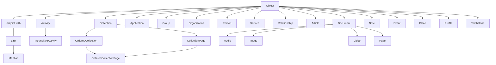

# ActivityStreams Vocabulary Registry

## Status

Design reference. This records the W3C ActivityStreams 2.0 Vocabulary as a
registry-shaped model for Axismundi. It does not introduce a runtime validator,
database schema, or a claim that the vocabulary is a closed JSON schema.

Source: [Activity Vocabulary](https://www.w3.org/TR/activitystreams-vocabulary/).
The specification defines vocabulary terms and inheritance, while ActivityPub
and individual FEPs define additional transport and interoperability contracts.

## Purpose

The registry is one shared description from which later work may derive:

- a protocol explorer and architecture graph;
- introspection of supported types and properties;
- projection capability declarations;
- query/index candidates; and
- opt-in validation profiles.

It is not the source of truth for a local WordPress object's ownership or
storage. A type may be projected from a post, a custom table, an Activity
ledger row, or a remote cache. A registry declaration says what an AS2 term
means, not where every product persists it.

## Registry Contract

Each type registration needs at least:

```text
term                 e.g. Question
iri                  https://www.w3.org/ns/activitystreams#Question
parent_terms         e.g. [IntransitiveActivity]
category             core | actor | activity | object | link | collection
provenance           as2-core | fep:<id> | product:<plugin>
projection_profiles  optional local source capabilities
declares_properties  property terms introduced at this type
excludes_properties  inherited terms not applicable at this type
status               standard | extension | deprecated
```

Each property registration needs at least:

```text
term                 e.g. inReplyTo
iri                  https://www.w3.org/ns/activitystreams#inReplyTo
spec_domain          exact RDF domain IRIs when the source declares them
spec_range           exact RDF range IRIs when the source declares them
rdf_functional       true | false | unspecified
value_shape          iri-or-object | link | string | timestamp | number | ...
runtime_cardinality  one | many | one-or-many
semantic_family      identity | content | relation | addressing | ...
provenance           as2-core | fep:<id> | product:<plugin>
index_hint           none | scalar | relation | full-text | collection
source               versioned specification URI and term anchor
implementation_notes short Axismundi-only explanation, when needed
```

`spec_domain`, `spec_range`, and `rdf_functional` record the source ontology
without changing its meaning. In RDF, a domain or range is not a closed
allow-list for a JSON payload. The local fields describe a different layer:
wire representation, normalization, and storage. They may refine an otherwise
open representation, but they may never contradict the imported AS2 semantics.
For example, a functional RDF property has one semantic value per subject even
if the JSON reader accepts either a singleton or a one-element array. A local
cardinality rule that permits multiple distinct values in that case is an
implementation defect, not an alternate Axismundi policy. `value_shape`,
`runtime_cardinality`, and `index_hint` are therefore constrained Axismundi
metadata and must remain explicitly marked as such.

Extensions register new terms by IRI and provenance. They never overwrite the
meaning of an AS2 core term. An inbound payload can preserve unknown terms as
unmapped extensions; a future strict outbound profile can reject only the
terms that its selected profile does not permit.

## Registry Serialization

The machine-readable source should be a checked-in, versioned JSON registry;
Markdown is the design explanation and a future rendered view. The runtime
must not scrape the W3C document or resolve arbitrary vocabulary URLs on a
request path. A registry snapshot records the source version and preserves
the distinction between specification facts and Axismundi decisions:

```json
{
  "iri": "https://www.w3.org/ns/activitystreams#property-name",
  "term": "property-name",
  "provenance": "as2-core",
  "source": {
    "specification": "https://www.w3.org/TR/activitystreams-vocabulary/",
    "anchor": "#property-name"
  },
  "rdf": {
    "domain": ["source-declared IRI"],
    "range": ["source-declared IRI"],
    "functional": "unspecified"
  },
  "axismundi": {
    "value_shape": "declared after protocol review",
    "runtime_cardinality": "one-or-many",
    "storage_route": "scalar | relation | ordered-members | raw-extension"
  },
  "implementation_notes": "Optional, short, and not an enforcement rule."
}
```

Use `null` or an empty list only to mean that the imported source does not
declare a value; never infer an absent RDF declaration as a closed rule. A
separate authoring profile may declare which types and values Axismundi emits.
Inbound federation remains permissive: known fields are normalized, while
unknown FEP or vendor fields survive in the raw-extension path.

Do not import the Vocabulary's prose wholesale as `notes`. Keep the stable
source URL and anchor for every term, then add `implementation_notes` only
where a local decision needs explanation, such as the distinction between
`inReplyTo` and a WordPress parent, or between `oneOf` and poll storage.

## Type Hierarchy

`Object` and `Link` are disjoint core types. An Activity is an Object; an
IntransitiveActivity is an Activity whose inherited `object` property does not
apply. `OrderedCollectionPage` has two parents.



The standard extended Activity tree is separate because it is large and
should not be confused with local source types:

```text
Activity
|- Accept
|  `- TentativeAccept
|- Add
|- Announce
|- Create
|- Delete
|- Dislike
|- Flag
|- Follow
|- Ignore
|  `- Block
|- Join
|- Leave
|- Like
|- Listen
|- Move
|- Offer
|  `- Invite
|- Read
|- Reject
|  `- TentativeReject
|- Remove
|- Undo
|- Update
`- View

IntransitiveActivity
|- Arrive
|- Question
`- Travel
```

Notes for local architecture:

- `Question` is an `IntransitiveActivity`, but can still be a durable,
  post-backed local source and can be embedded in a `Create` Activity.
- `Like`, `Announce`, `Follow`, and similar event-first types can be authored
  directly into the Activity ledger without a WordPress post source.
- `Article`, `Note`, `Event`, and `Place` do not prescribe a CPT. A product
  selects a source and registers an explicit projection profile.
- `Document` is the parent of `Audio`, `Image`, `Video`, and `Page`. For a
  WordPress attachment, MIME type is a local discriminator for one of those
  projections; it is not an AS2 inheritance rule.

## Effective Property Sets

A type's effective core-property set is the union of its direct parent's
effective set and its own declarations, less explicit exclusions. This gives
the registry a useful internal conformance contract without claiming that
ActivityStreams forbids every extension property not named below.

```text
effective_properties(type) =
  union(effective_properties(parent))
  + declares_properties(type)
  - excludes_properties(type)
```

The core declarations to seed that contract are:

```text
Object
  attachment, attributedTo, audience, content, context, name, endTime,
  generator, icon, image, inReplyTo, location, preview, published, replies,
  startTime, summary, tag, updated, url, to, bto, cc, bcc, mediaType, duration

Activity (inherits Object)
  actor, object, target, result, origin, instrument

IntransitiveActivity (inherits Activity)
  excludes object

Question (inherits IntransitiveActivity)
  oneOf, anyOf, closed

Collection (inherits Object)
  totalItems, current, first, last, items
OrderedCollection (inherits Collection)
  orderedItems
CollectionPage (inherits Collection)
  partOf, next, prev
OrderedCollectionPage (inherits OrderedCollection and CollectionPage)
  startIndex

Relationship (inherits Object)
  subject, object, relationship
Place (inherits Object)
  accuracy, altitude, latitude, longitude, radius, units
Profile (inherits Object)
  describes
Tombstone (inherits Object)
  formerType, deleted

Link
  href, rel, mediaType, name, hreflang, height, width, preview
Mention (inherits Link)
```

`Application`, `Group`, `Organization`, `Person`, `Service`, `Article`,
`Document`, `Audio`, `Image`, `Video`, `Page`, `Note`, and `Event` inherit
their listed parent's core properties without a further core declaration here.
`Accept`, `Add`, `Create`, and the other concrete Activity terms likewise
inherit Activity's set unless an extension profile declares more.

### Worked Expansion: Question

The durable Question ledger takes its columns from this set rather than from
improvisation, so the expansion is written out once, with the storage route
each property takes.

```text
effective_properties(Question) =
  Object's set + { actor, target, result, origin, instrument } + { oneOf, anyOf, closed }
  - object
```

```text
scalar on the row        content, contentMap, name, nameMap, summary, summaryMap,
                         published, updated, startTime, endTime, duration,
                         mediaType, url, closed
relation occurrence      attachment, attributedTo, actor, audience, context,
                         icon, image, inReplyTo, location, preview, tag,
                         target, result, origin, instrument
addressing snapshot      to, cc, bto, bcc
ordered members          oneOf, anyOf
derived collection       replies
identity, not a column   id and type: id is the identity row, type is a
                         rebuildable projection the owning source declares
raw payload              every unregistered extension received
```

Five things this expansion settles that a column list would have guessed at.

- `oneOf` and `anyOf` are not two stores. They are one ordered option set plus
  a selection mode; the emitted key follows the mode, and the rows do not move
  when it changes.
- `closed` is not a datetime column. AS2 allows a timestamp, a boolean, or an
  Object, so a lone datetime cannot express "closed, time unknown". The row
  needs the flag and the time separately.
- `actor` and `attributedTo` both survive the expansion, and both are real.
  A Question is an Activity, so `actor` is its performer; the fediverse writes
  polls with `attributedTo` and that is what interoperates. Keep both: emit for
  compatibility, retain what was received.
- `replies` and the tally read the same edges. A vote is a `Create(Note)` whose
  `inReplyTo` is the Question, so a naive reply count counts votes. The
  classifier that already separates them -- empty content, exact frozen option
  name -- is what the collection must consult, not the edge table alone.
- A content warning is `summary` with the `sensitive` extension, so it travels
  with `content` for retention. `sensitive` is not core AS2 and is registered
  as an extension with its own provenance, not quietly treated as a core term.

### Validation And Storage Are Different Questions

This property contract can constrain an authored write without turning every
property into an undifferentiated key/value row. A future property writer first
calculates the effective set for the resource type, then routes a registered
property by its `value_shape` and `index_hint`:

| Value family | Durable projection | Example |
| --- | --- | --- |
| scalar or language-map property | typed property row or a source-specific scalar projection | `name`, `content`, `closed` |
| Object/Link/IRI relation | relation occurrence with target resource or URI and Link descriptor | `attachment`, `tag`, `inReplyTo` |
| ordered member | membership/options table with stable member identity and position | `orderedItems`, `oneOf` |
| addressing snapshot | Activity ledger or audience relation projection | `to`, `cc`, `audience` |

The proposed property layer is therefore an enforcement and typed-projection
boundary, not an instruction to put relation lists, poll options, or raw remote
JSON into one `objectmeta` EAV table. Local authored writes can be strict:
reject an unregistered property or one excluded by the selected type. Inbound
payloads remain permissive: preserve unknown or unregistered FEP/vendor fields
in the raw representation, and project them only after a provenance-bearing
extension registration exists.

### One Vocabulary Authority, Several Value Authorities

The type hierarchy, property definitions, inheritance/exclusion rules, value
shapes, and extension provenance have one authority: the vocabulary registry.
The value of a property does not. It remains owned by the aggregate whose
lifecycle made it true:

| Aggregate | Property-value authority | Examples |
| --- | --- | --- |
| Actor | Actors identity/profile source and its typed projections | `name`, `icon`, `inbox`, public-key material |
| Object | local post/native source or remote Object cache, plus Object relation projections | `content`, `attributedTo`, `attachment`, `inReplyTo` |
| Activity | immutable Activity ledger payload and ledger columns | `actor`, `object`, `target`, `to`, `published` |
| Collection | collection/membership source and ordered-member projection | `items`, `orderedItems`, `totalItems` |

Consequently, do not create one authoritative `actor_meta | object_meta |
activity_meta | collection_meta` replacement table. That would duplicate
different revision, retention, and mutability rules under a uniform key/value
shape. Instead, the registry supplies a property binding: for a resource kind,
source kind, and registered property, it selects the validator and the owning
writer/reader. A future cross-resource `property_values` table may exist as a
rebuildable typed index for a named query or a registered extension, carrying
owner kind/ID, property IRI, representation revision, and provenance. It is
not the authority for Core post fields, Actor profiles, immutable Activities,
or collection membership.

## Core Property Registry

The following table covers the core Vocabulary property names. “Primary
semantic use” is a registry aid, not an exclusive allowed-type list: the AS2
vocabulary deliberately permits extension and composition.

| Property | Value shape | Primary semantic use | Index hint |
| --- | --- | --- | --- |
| `id` | IRI | canonical identity | scalar unique |
| `type` | term or term list | type membership | scalar/type set |
| `mediaType` | media type | representation | scalar |
| `url` | IRI, Link, or list | human/machine representation | relation |
| `name`, `nameMap` | string, language map | display name | full-text |
| `summary`, `summaryMap` | string, language map | summary | full-text |
| `content`, `contentMap` | string, language map | authored body | full-text |
| `published`, `updated` | timestamp | resource time | scalar |
| `attachment` | Object or Link list | attached resources | relation |
| `attributedTo` | Object or Link list | authorship attribution | relation |
| `audience` | Object or Link list | addressed audience context | relation |
| `context` | Object or Link | shared conversation/context | relation |
| `generator` | Object or Link | generating application/service | relation |
| `icon`, `image` | Object or Link | visual representation | relation |
| `inReplyTo` | Object or Link list | direct reply parent | relation |
| `location` | Object or Link | place/location | relation |
| `preview` | Object or Link | preview resource | relation |
| `replies` | Collection | replies collection | relation |
| `tag` | Object or Link list | tags, mentions, hashtags | relation |
| `to`, `cc`, `bto`, `bcc` | Object or Link list | delivery addressing | relation |
| `actor` | Object or Link | Activity performer | relation |
| `object` | Object, Link, or IRI | Activity direct object | relation |
| `target` | Object, Link, or IRI | Activity target/context | relation |
| `result` | Object, Link, or IRI | Activity result | relation |
| `origin` | Object, Link, or IRI | Activity origin | relation |
| `instrument` | Object or Link | instrument used for Activity | relation |
| `items` | Object or Link list | Collection members | collection |
| `orderedItems` | Object or Link list | ordered Collection members | collection |
| `current`, `first`, `last`, `next`, `prev`, `partOf` | CollectionPage or Link | collection navigation/membership | relation |
| `totalItems`, `startIndex` | integer | collection cardinality/offset | scalar |
| `oneOf`, `anyOf`, `closed` | Object/Link list, timestamp | Question options and closure | relation/scalar |
| `accuracy`, `altitude`, `latitude`, `longitude`, `radius`, `units` | number or string | Place geometry | scalar |
| `duration`, `startTime`, `endTime` | duration or timestamp | temporal extent | scalar |
| `height`, `width` | integer | Link/media dimensions | scalar |
| `href`, `hreflang`, `rel` | IRI or string | Link target and relation | scalar |
| `subject`, `relationship` | Object, Link, or IRI | Relationship endpoints/type | relation |
| `describes` | Object or Link | Profile subject | relation |
| `formerType`, `deleted` | term, timestamp | Tombstone history | scalar |

## Property Families and Local Boundaries

The property registry should guide storage choice without forcing all values
into post meta.

| Family | Examples | Default durable form |
| --- | --- | --- |
| Identity and lifecycle | `id`, `type`, `published`, `updated`, `deleted` | source row plus object/activity registry |
| Local scalar authoring settings | visibility policy, language choice, content warning | source-specific settings or registered post meta |
| Object relations | `inReplyTo`, `attachment`, `tag`, `attributedTo`, `context` | URI-keyed relation table; not duplicated as authoritative post meta |
| Addressing/delivery snapshot | `to`, `cc`, `bto`, `bcc`, `audience` | Activity ledger snapshot; source stores editable intent only |
| Ordered structured members | Question options, collection items | domain table with order and stable member identity |
| Remote/unmapped extensions | FEP or instance fields | preserved raw payload plus extension registry/projection |

This keeps WordPress post meta useful for local editor-facing scalar settings
without pretending that a key/value store can provide a durable graph,
collection ordering, or Activity delivery history.

## Projection Profiles Are Separate From Type Terms

A projection profile connects a local source to an AS2 type. It does not alter
the type hierarchy. Initial examples:

| Local source | Profile result | Selection rule | Status |
| --- | --- | --- | --- |
| core `post` | `Article` | explicit core post profile | proposed |
| core `attachment` | `Image`, `Audio`, `Video`, or `Document` | `post_mime_type` | proposed |
| `ax_note` | `Note` | no Question row, no Quote form | existing domain behavior |
| `ax_note` + Question rows | `Question` | structured poll definition | existing domain behavior |
| Calendar source | `Event` | Calendar-owned profile | existing product direction |
| core `page` | no default | explicit opt-in only | proposed |
| Activity ledger row | Activity subtype | direct Activity authoring | proposed |

`post_status = publish` is a visibility/lifecycle condition, never a sufficient
projection selection rule. A published template, navigation item, or site page
is not automatically federated content.

## Where The Registry Lives, And What Stays With Each Product

Decided 2026-10-17. The registry is held by Axismundi Object Projections,
because the projector composes a document from it and there is no reason to
ship an input apart from its only consumer. A local Actor is a local Object:
Object Projections already assembles the Actor document
(`includes/integrations/actors.php`), and Axismundi Actors contains no AS2
assembly at all -- not one `@context` -- so "the projector lives here" is the
measured present state rather than a proposal.

An earlier objection, that Actors and Activities must be able to answer type
questions without the representation plugin, was about a consumer that does not
exist. Measured the same day: no plugin references `IntransitiveActivity`
anywhere, so the type hierarchy exists only in this document. What those
plugins do carry is a different thing, and it stays with them:

| Kind of fact | Example | Owner |
| --- | --- | --- |
| Vocabulary fact | `Question` inherits `IntransitiveActivity`, which excludes `object` | the registry, in Object Projections |
| Product support list | the 22 Activity types this instance accepts (`axismundi-activities/includes/repository.php`), the five Actor types (`axismundi-actors/includes/repository.php`) | each plugin |

A support list says what a product authors or accepts; it is not a claim about
what the vocabulary contains. Keeping them apart is what lets every plugin keep
working with Object Projections absent -- only assembling a document needs the
registry.

The first deliverable is therefore not abstract. The five Actor types are
written out twice inside Actors alone (`repository.php` and
`remote-discovery.php`), which is the duplication the registry removes.

What a product binds the supplied property set to -- post meta, term meta, a
custom table, an editor control -- stays the product's own decision. The
registry selects the validator and the owning reader/writer for a resource
kind, source kind and property; it holds no values, and the prohibition above
against one uniform `*_meta` table is unchanged.

## Extension Registration

Decided 2026-10-17: **the owner of a feature registers its terms.** This is
already how the implementation works -- `axismundi-emoji/includes/outbound.php`
adds its FEP-9098 terms through the `axismundi_op_jsonld_context` filter, and
Object Projections' own Media Library integration adds its terms the same way,
so Object Projections owns the registration point and not the content. Twelve
FEP identifiers appear across the plugins and they sit with the product that
owns each feature: FEP-8a8e with Calendar, FEP-c0e0 and FEP-9098 with Emoji,
FEP-044f with Activities, FEP-1b12 with the Group work.

Object Projections registering FEP-1311, FEP-b2b8 or the fedibird reaction term
is the same rule, not an exception: those are representation conventions for
objects it projects itself. One rule -- the feature's owner registers -- avoids
having to adjudicate per FEP which side a term belongs to.

The stakes are lower than they look, because an unregistered term is not lost:
inbound preservation keeps unknown FEP and vendor fields in the raw-extension
path. Registration buys normalization, validation and indexing, so a product may
implement an FEP first and register its terms later.

Two requirements the current `@context` filter does not meet, and the
registration API must:

- **Conflicting re-registration is detected, not merged.** The filter merges, so
  two plugins registering one IRI with different value shapes or cardinalities
  resolve by last writer and then disagree quietly.
- **An extension never overwrites an AS2 core term's meaning**, which is stated
  above and needs to be checked rather than assumed.

When the registry and projector exist, the Emoji plugin's registration moves
from that context filter to the registration API. It is the clearest case to
migrate first: it is a product-owned FEP, it already registers rather than
being special-cased, and its terms are small enough that the migration tests
the API rather than the plugin.

An FEP or product extension should provide a compact manifest rather than
modify this core table:

```yaml
extension: fep-044f
provenance: https://codeberg.org/fediverse/fep/src/branch/main/fep/044f
terms:
  - term: quoteAuthorization
    iri: https://w3id.org/fep/044f#quoteAuthorization
    kind: property
    value_shape: iri-or-object
    semantic_family: relation
    applies_to: [Note, Article]
    index_hint: relation
```

The exact manifest format is intentionally undecided. Before it becomes an API,
the architecture graph and documentation can use the same conceptual fields.

## Deferred Work

- Define a machine-readable registry format and ownership/loading rules.
- Distinguish validation profiles: inbound preservation, inbound compatibility,
  local authoring, outbound federation, and product-specific strict modes.
- Map every registered property to a source, relation, registry, or payload
  preservation location.
- Decide which extension terms deserve materialized indexes based on observed
  queries rather than generating indexes from every registered property.
