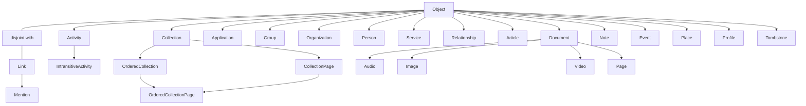

# ActivityStreams Vocabulary Registry

## Status

Design reference. This records the W3C ActivityStreams 2.0 Vocabulary as a
registry-shaped model for Axismundi. It does not introduce a runtime validator,
database schema, or a claim that the vocabulary is a closed JSON schema.

Source: [Activity Vocabulary](https://www.w3.org/TR/activitystreams-vocabulary/).
The specification defines vocabulary terms and inheritance, while ActivityPub
and individual FEPs define additional transport and interoperability contracts.

## Purpose

The registry is one shared description from which later work may derive:

- a protocol explorer and architecture graph;
- introspection of supported types and properties;
- projection capability declarations;
- query/index candidates; and
- opt-in validation profiles.

It is not the source of truth for a local WordPress object's ownership or
storage. A type may be projected from a post, a custom table, an Activity
ledger row, or a remote cache. A registry declaration says what an AS2 term
means, not where every product persists it.

## Registry Contract

Each type registration needs at least:

```text
term                 e.g. Question
iri                  https://www.w3.org/ns/activitystreams#Question
parent_terms         e.g. [IntransitiveActivity]
category             core | actor | activity | object | link | collection
provenance           as2-core | fep:<id> | product:<plugin>
projection_profiles  optional local source capabilities
declares_properties  property terms introduced at this type
excludes_properties  inherited terms not applicable at this type
status               standard | extension | deprecated
```

Each property registration needs at least:

```text
term                 e.g. inReplyTo
iri                  https://www.w3.org/ns/activitystreams#inReplyTo
spec_domain          exact RDF domain IRIs when the source declares them
spec_range           exact RDF range IRIs when the source declares them
rdf_functional       true | false | unspecified
value_shape          iri-or-object | link | string | timestamp | number | ...
runtime_cardinality  one | many | one-or-many | unspecified
jsonld_container     null | @list | @language | another declared JSON-LD container
semantic_family      identity | content | relation | addressing | ...
provenance           as2-core | fep:<id> | product:<plugin>
index_hint           none | scalar | relation | full-text | collection
source               versioned specification URI and term anchor
implementation_notes short Axismundi-only explanation, when needed
```

`spec_domain`, `spec_range`, and `rdf_functional` record the source ontology
without changing its meaning. In RDF, a domain or range is not a closed
allow-list for a JSON payload. The local fields describe a different layer:
wire representation, normalization, and storage. They may refine an otherwise
open representation, but they may never contradict the imported AS2 semantics.
For example, a functional RDF property has one semantic value per subject even
if the JSON reader accepts either a singleton or a one-element array. A local
cardinality rule that permits multiple distinct values in that case is an
implementation defect, not an alternate Axismundi policy. `value_shape`,
`runtime_cardinality`, and `index_hint` are therefore constrained Axismundi
metadata and must remain explicitly marked as such.

`value_shape` describes the value of the expanded RDF predicate. A JSON key's
container is a separate fact: `items` and `orderedItems`, for example, both
expand to `as:items` and carry the same member value shape, while only
`orderedItems` has the `@list` container required by Core section 4.6. Keeping
that fact in `jsonld_container` lets aliases share one predicate and shape
without making an unordered collection claim to be ordered.

`unspecified` is a real state, not a missing default. It says the snapshot has
recorded the term's wire shape but has not yet made a local runtime-cardinality
claim after protocol review. A loader must not turn that absence into
`one-or-many`: doing so makes an unresearched value look like a positive local
contract. A compact string entry in the JSON snapshot is precisely this
shape-only form; an object entry is used when a term needs an explicit IRI,
source, provenance, cardinality, or another non-default fact.

Extensions register new terms by IRI and provenance. They never overwrite the
meaning of an AS2 core term. An inbound payload can preserve unknown terms as
unmapped extensions; a future strict outbound profile can reject only the
terms that its selected profile does not permit.

## Normative Requirements Are A Third Registration

A type registration describes a term. A property registration describes a term.
Neither can hold "an actor has to have an `inbox`", because that is not a fact
about the `inbox` term -- it is a conformance rule bound to the Actor type by a
different specification. Recording normative requirements therefore needs its
own registration shape:

```text
subject            Actor | Activity | Object | Collection | a property | an endpoint
level              MUST | MUST NOT | SHOULD | SHOULD NOT | MAY
conformance_class  which class of software the source binds
source             specification URI + section anchor
kind               payload | behaviour
enforced_by        the command that fails when it is broken, or `convention`
```

`conformance_class` is not optional. A specification's MUST binds a class, and
a list that drops the class is how a client requirement gets enforced on a
server payload. `enforced_by` is not optional either, for the reason stated in
AGENTS.md: a rule without a named command is a convention, and recording one as
though it were enforced is worse than not recording it.

`kind` is what makes the register finite. Only a `payload` rule constrains the
content of a document, so only a `payload` rule can be checked by looking at
what we emit; a `behaviour` rule about delivery, retries or HTTP status codes
needs an integration test or nothing.

### Which specifications the requirements come from

Collected 2026-10-17 and measured rather than assumed:

| Source | What it contributes | Conformance classes |
| --- | --- | --- |
| Activity Streams 2.0 Core, W3C Recommendation 23 May 2017 | 71 requirements, 45 payload | conforming document, implementation, publisher, consumer (§9) |
| **ActivityPub, W3C Recommendation 23 January 2018** (`https://www.w3.org/TR/activitypub/`) | the normative source | conformant Client, Server, Federated Server |
| W3C Security Vocabulary / HTTP Signatures practice | `publicKey`, `publicKeyPem` | none; de-facto fediverse convention |

The ActivityPub row is a published Recommendation and the register anchors to
it. The collection that produced these counts -- 137 requirements, 40 of them
payload -- was taken from the **Editor's Draft** at
`https://w3c.github.io/activitypub/`, which carries errata the Recommendation
does not, so the two are not interchangeable. The draft is comparison material.
Every requirement promoted into the register is re-checked against the
Recommendation and anchored there, because a register whose job is to say where
a rule comes from cannot cite the wrong document.

One measured consequence of reading the Recommendation itself: the guidance that
a `Create`'s actor be copied onto the object's `attributedTo` is a **SHOULD**,
not a MUST. Attribution is therefore local policy resting on a recommendation,
which is worth knowing before building rules on top of it.

The third row is the finding worth keeping. **`publicKey` appears nowhere in
ActivityPub** -- zero occurrences in the fetched Editor's Draft, which handles
client keys through `provideClientKey` and `signClientKey` instead -- and it is
not an AS2 Vocabulary term either. Our Actor documents emit it because the
fediverse requires it in practice. A strict profile scoped to "AS2 plus
ActivityPub terms" would reject the one property without which no peer can
verify our signatures, so the registry carries a third provenance for de-facto
terms and does not pretend they have a normative home.

Two more scoping facts from the same collection. Of ActivityPub's requirements,
15 bind the **Client** class, which this project is not: a server must not
enforce them on itself. And both specifications write much of their security
and conformance prose in lower-case "should" and "must", which RFC 2119 does
not bind -- AS2 Core writes all of §9 that way, and ActivityPub's §9 contains
exactly one upper-case keyword. Those lines are recorded at the level the word
implies and marked, never cited as capitalised requirements.

### Five JSON keys are sourced somewhere other than the Vocabulary

A snapshot entry asserted `https://www.w3.org/ns/activitystreams#orderedItems`, an IRI that
does not exist, with a Vocabulary anchor that is a dead link. Chasing it produced a rule the
registry needs.

The Vocabulary's property section defines `items` and never defines `orderedItems`, and
`orderedItems` appears there only inside examples. That is not an omission. **Activity
Streams 2.0 Core section 4.6 is where it is stated**: in the JSON serialization a
Collection's unordered items use `items` while its ordered items use `orderedItems`. So it
is a property at the JSON level with a normative source -- just a different document from
the one our snapshot cited.

The normative context at `https://www.w3.org/ns/activitystreams` (148 terms, read
2026-10-17) shows the mechanism, and exactly five of its terms have an `@id` that is not
`as:<term>`:

```json
"orderedItems": { "@id": "as:items",    "@type": "@id", "@container": "@list" }
"nameMap":      { "@id": "as:name",                     "@container": "@language" }
"summaryMap":   { "@id": "as:summary",                  "@container": "@language" }
"contentMap":   { "@id": "as:content",                  "@container": "@language" }
"inbox":        { "@id": "ldp:inbox",   "@type": "@id" }
```

One RDF predicate, two JSON spellings, and the spelling carries the ordering or the
language mapping. The three `Map` keys have the same shape and their source is Core section
4.7, which is also where the two MUSTs about BCP 47 keys and string values live.

Two things follow for the registry, and the first is the reason this is recorded at all:

- **A term's `iri` is the predicate it expands to, not `as:` plus its own name.** For these
  five, deriving the IRI from the term produces a predicate nobody else uses, and a
  consumer expanding our document with it reads a different statement than the rest of the
  fediverse. Deriving a Vocabulary anchor from the term fails the same way, visibly, with a
  link that goes nowhere.
- **Their `source` is Core or the context, not the Vocabulary.** The register exists to say
  which document a fact comes from, so citing the wrong one is the failure it is meant to
  prevent.

`inbox` is a third case again. ActivityPub requires it on an actor and the context maps it
to `ldp:inbox`, so its vocabulary is the Linked Data Platform and neither of the two
specifications we collected owns it. It joins `publicKey` among terms whose provenance is a
document outside this pair.

The consequence for member order is narrow and benign: the renderer orders **JSON keys**, so
naming `name` and `nameMap` separately there is correct. The distinction matters where
properties are identified or counted.

### Findings that change rules we had already written

Five results from the same collection contradicted or re-sourced something this
project believed. They are kept because each one would otherwise be
re-discovered, and because three of them are about *which document* a rule comes
from, which is the mistake the `source` field exists to prevent.

| Finding | Why it matters here |
| --- | --- |
| `@context` is a **SHOULD**, not a MUST (Core §2.1 `#jsonld`), and §2.1.3 states the inverse MUST: a consumer receiving `application/activity+json` without a context reference has to assume the normative context anyway | Object Projections' rule that the renderer owns `@context` alone is **ours and stricter than the specification**. It must not be recorded as a specification requirement |
| `id` and `type` are **optional** in Core -- §4.1 says all Object properties are, "including the `id` and `type`" | "An object must have an `id`" is ActivityPub's requirement (§3.1 `#obj-id`), not AS2's. Our renderer rejecting an `id` that is not the declared object URI is a third thing again: our own invariant |
| The prohibition on HTML in `name` is a **MUST NOT**, and it is in the **Vocabulary**, not in Core | Core contains no such rule; its only markup rule is a SHOULD NOT on `summary`, and only when `name` is absent (§4.1.1). Stripping tags from `name` is therefore required of us, and the requirement's anchor is the Vocabulary's `name` definition |
| Core §5 is a **MUST**: a consumer meeting an unfamiliar extension property may not stop processing or signal an error, and continues as if it were absent. §5.2 adds SHOULDs to preserve extension properties and the original `@context` across re-serialisation | Preserving unknown FEP and vendor terms in the raw-extension path is **normative**, not a convenience we chose. It is also the reason registration buys normalisation and indexing rather than survival |
| An extension type that **overlaps** a core vocabulary type has to carry the core type too -- three parallel MUSTs, Core §4.1 (Object), §4.3 (Actor), §4.4 (Activity), with `gr:Location`/`Place` and `vcard:Individual`/`Person` as the examples | No current payload violates this: a FEP type such as `EmojiReact` overlaps no core type. It becomes live the moment an Actor is also typed through a foreign vocabulary, which the JSContact direction could reach |

One deliberate deviation belongs with them. Core §5 says to provide an
`@context` definition for every extension property emitted, and one of ours is
emitted as a fully expanded IRI key with no definition:
`http://fedibird.com/ns#emojiReactions`. That is intentional and the reason is
in the code (`axismundi-object-projections/includes/integrations/reactions.php`)
-- the full key is kept so a peer that does not compact the context term still
finds the property, and the scheme is `http` rather than `https` because in
JSON-LD the IRI *is* the property name, so the two spell different terms and the
FEP and its sibling namespaces write it the first way. The SHOULD is traded
away knowingly. It could also be satisfied without changing the emitted key, by
declaring an alias in the context while continuing to emit the expanded form,
since both compact to the same property; that is a small improvement and not a
correction.

### What is kept here, and what is not

AGENTS.md forbids keeping a copy of upstream current in this repository, and a
paraphrase of 208 normative sentences is exactly the kind of mirror that rule
is about: it would drift, and the drift would be invisible. So the register
holds only the requirements this project has chosen to check, each pointing at
its specification anchor -- a list of our checks, not a copy of the specs. The
full collection stays working material.

### Seeds: what is already enforced

Three rules of this shape are already in force, and naming them is what turns
the register into a difference rather than an inventory:

| Requirement | Where | Enforced by |
| --- | --- | --- |
| An object's `id` equals the object URI its transformer declared | Object Projections SPEC.md section 4.1 | the renderer rejects a mismatch |
| `@context` is assembled in one place; a transformer supplying one has it stripped | SPEC.md section 4.2 | the renderer |
| An Actor without a key fails closed, inbox and key written atomically | ActivityPub Bridge | its own audit |

And one honest qualification measured the same day: the ActivityPub MUSTs that
an actor object carry `inbox` and `outbox` do hold in our output, and a
regression would be caught -- but only incidentally, by a composite condition
inside `audit-actor-projection.php` whose subject is transport-field override.
A requirement enforced as a side effect of another test is the case
`enforced_by` exists to make visible.

## Registry Serialization

The machine-readable source should be a checked-in, versioned JSON registry;
Markdown is the design explanation and a future rendered view. The runtime
must not scrape the W3C document or resolve arbitrary vocabulary URLs on a
request path. A registry snapshot records the source version and preserves
the distinction between specification facts and Axismundi decisions:

```json
{
  "iri": "https://www.w3.org/ns/activitystreams#property-name",
  "term": "property-name",
  "provenance": "as2-core",
  "source": {
    "specification": "https://www.w3.org/TR/activitystreams-vocabulary/",
    "anchor": "#property-name"
  },
  "rdf": {
    "domain": ["source-declared IRI"],
    "range": ["source-declared IRI"],
    "functional": "unspecified"
  },
  "axismundi": {
    "value_shape": "declared after protocol review",
    "runtime_cardinality": "one-or-many",
    "storage_route": "scalar | relation | ordered-members | raw-extension"
  },
  "implementation_notes": "Optional, short, and not an enforcement rule."
}
```

Use `null` or an empty list only to mean that the imported source does not
declare a value; never infer an absent RDF declaration as a closed rule. A
separate authoring profile may declare which types and values Axismundi emits.
Inbound federation remains permissive: known fields are normalized, while
unknown FEP or vendor fields survive in the raw-extension path.

Do not import the Vocabulary's prose wholesale as `notes`. Keep the stable
source URL and anchor for every term, then add `implementation_notes` only
where a local decision needs explanation, such as the distinction between
`inReplyTo` and a WordPress parent, or between `oneOf` and poll storage.

The bundled property table is a **closed project subset**, not a mirror or a
count of every upstream property. It contains the universal terms and every
term a registered type declares or excludes; the loader rejects a type that
references a missing definition. That closure makes the table useful without
turning this repository into an upstream copy. A property outside the subset
can still survive inbound as a raw extension, and is added only when this
project needs its normalization, validation, indexing, or a registered type
contract.

## Type Hierarchy

`Object` and `Link` are disjoint core types. An Activity is an Object; an
IntransitiveActivity is an Activity whose inherited `object` property does not
apply. `OrderedCollectionPage` has two parents.



The standard extended Activity tree is separate because it is large and
should not be confused with local source types:

```text
Activity
|- Accept
|  `- TentativeAccept
|- Add
|- Announce
|- Create
|- Delete
|- Dislike
|- Flag
|- Follow
|- Ignore
|  `- Block
|- Join
|- Leave
|- Like
|- Listen
|- Move
|- Offer
|  `- Invite
|- Read
|- Reject
|  `- TentativeReject
|- Remove
|- Undo
|- Update
`- View

IntransitiveActivity
|- Arrive
|- Question
`- Travel
```

Notes for local architecture:

- `Question` is an `IntransitiveActivity`, but can still be a durable,
  post-backed local source and can be embedded in a `Create` Activity.
- `Like`, `Announce`, `Follow`, and similar event-first types can be authored
  directly into the Activity ledger without a WordPress post source.
- `Article`, `Note`, `Event`, and `Place` do not prescribe a CPT. A product
  selects a source and registers an explicit projection profile.
- `Document` is the parent of `Audio`, `Image`, `Video`, and `Page`. For a
  WordPress attachment, MIME type is a local discriminator for one of those
  projections; it is not an AS2 inheritance rule.

## Effective Property Sets

A type's effective core-property set is the union of its direct parent's
effective set and its own declarations, less explicit exclusions. This gives
the registry a useful internal conformance contract without claiming that
ActivityStreams forbids every extension property not named below.

```text
effective_properties(type) =
  union(effective_properties(parent))
  + declares_properties(type)
  - excludes_properties(type)
```

The core declarations to seed that contract are:

```text
Object
  attachment, attributedTo, audience, content, context, name, endTime,
  generator, icon, image, inReplyTo, location, preview, published, replies,
  startTime, summary, tag, updated, url, to, bto, cc, bcc, mediaType, duration

Activity (inherits Object)
  actor, object, target, result, origin, instrument

IntransitiveActivity (inherits Activity)
  excludes object

Question (inherits IntransitiveActivity)
  oneOf, anyOf, closed

Collection (inherits Object)
  totalItems, current, first, last, items
OrderedCollection (inherits Collection)
  orderedItems
CollectionPage (inherits Collection)
  partOf, next, prev
OrderedCollectionPage (inherits OrderedCollection and CollectionPage)
  startIndex

Relationship (inherits Object)
  subject, object, relationship
Place (inherits Object)
  accuracy, altitude, latitude, longitude, radius, units
Profile (inherits Object)
  describes
Tombstone (inherits Object)
  formerType, deleted

Link
  href, rel, mediaType, name, hreflang, height, width, preview
Mention (inherits Link)
```

`Application`, `Group`, `Organization`, `Person`, `Service`, `Article`,
`Document`, `Audio`, `Image`, `Video`, `Page`, `Note`, and `Event` inherit
their listed parent's core properties without a further core declaration here.
`Accept`, `Add`, `Create`, and the other concrete Activity terms likewise
inherit Activity's set unless an extension profile declares more.

### Worked Expansion: Question

The durable Question ledger takes its columns from this set rather than from
improvisation, so the expansion is written out once, with the storage route
each property takes.

```text
effective_properties(Question) =
  Object's set + { actor, target, result, origin, instrument } + { oneOf, anyOf, closed }
  - object
```

```text
scalar on the row        content, contentMap, name, nameMap, summary, summaryMap,
                         published, updated, startTime, endTime, duration,
                         mediaType, url, closed
relation occurrence      attachment, attributedTo, actor, audience, context,
                         icon, image, inReplyTo, location, preview, tag,
                         target, result, origin, instrument
addressing snapshot      to, cc, bto, bcc
ordered members          oneOf, anyOf
derived collection       replies
identity, not a column   id and type: id is the identity row, type is a
                         rebuildable projection the owning source declares
raw payload              every unregistered extension received
```

Five things this expansion settles that a column list would have guessed at.

- `oneOf` and `anyOf` are not two stores. They are one ordered option set plus
  a selection mode; the emitted key follows the mode, and the rows do not move
  when it changes.
- `closed` is not a datetime column. AS2 allows a timestamp, a boolean, or an
  Object, so a lone datetime cannot express "closed, time unknown". The row
  needs the flag and the time separately.
- `actor` and `attributedTo` both survive the expansion, and both are real.
  A Question is an Activity, so `actor` is its performer; the fediverse writes
  polls with `attributedTo` and that is what interoperates. Keep both: emit for
  compatibility, retain what was received.
- `replies` and the tally read the same edges. A vote is a `Create(Note)` whose
  `inReplyTo` is the Question, so a naive reply count counts votes. The
  classifier that already separates them -- empty content, exact frozen option
  name -- is what the collection must consult, not the edge table alone.
- A content warning is `summary` with the `sensitive` extension, so it travels
  with `content` for retention. `sensitive` is not core AS2 and is registered
  as an extension with its own provenance, not quietly treated as a core term.

### Validation And Storage Are Different Questions

This property contract can constrain an authored write without turning every
property into an undifferentiated key/value row. A future property writer first
calculates the effective set for the resource type, then routes a registered
property by its `value_shape` and `index_hint`:

| Value family | Durable projection | Example |
| --- | --- | --- |
| scalar or language-map property | typed property row or a source-specific scalar projection | `name`, `content`, `closed` |
| Object/Link/IRI relation | relation occurrence with target resource or URI and Link descriptor | `attachment`, `tag`, `inReplyTo` |
| ordered member | membership/options table with stable member identity and position | `orderedItems`, `oneOf` |
| addressing snapshot | Activity ledger or audience relation projection | `to`, `cc`, `audience` |

The proposed property layer is therefore an enforcement and typed-projection
boundary, not an instruction to put relation lists, poll options, or raw remote
JSON into one `objectmeta` EAV table. Local authored writes can be strict:
reject an unregistered property or one excluded by the selected type. Inbound
payloads remain permissive: preserve unknown or unregistered FEP/vendor fields
in the raw representation, and project them only after a provenance-bearing
extension registration exists.

### One Vocabulary Authority, Several Value Authorities

The type hierarchy, property definitions, inheritance/exclusion rules, value
shapes, and extension provenance have one authority: the vocabulary registry.
The value of a property does not. It remains owned by the aggregate whose
lifecycle made it true:

| Aggregate | Property-value authority | Examples |
| --- | --- | --- |
| Actor | Actors identity/profile source and its typed projections | `name`, `icon`, `inbox`, public-key material |
| Object | local post/native source or remote Object cache, plus Object relation projections | `content`, `attributedTo`, `attachment`, `inReplyTo` |
| Activity | immutable Activity ledger payload and ledger columns | `actor`, `object`, `target`, `to`, `published` |
| Collection | collection/membership source and ordered-member projection | `items`, `orderedItems`, `totalItems` |

Consequently, do not create one authoritative `actor_meta | object_meta |
activity_meta | collection_meta` replacement table. That would duplicate
different revision, retention, and mutability rules under a uniform key/value
shape. Instead, the registry supplies a property binding: for a resource kind,
source kind, and registered property, it selects the validator and the owning
writer/reader. A future cross-resource `property_values` table may exist as a
rebuildable typed index for a named query or a registered extension, carrying
owner kind/ID, property IRI, representation revision, and provenance. It is
not the authority for Core post fields, Actor profiles, immutable Activities,
or collection membership.

## Core Property Registry

The following table covers the core Vocabulary property names. “Primary
semantic use” is a registry aid, not an exclusive allowed-type list: the AS2
vocabulary deliberately permits extension and composition.

| Property | Value shape | Primary semantic use | Index hint |
| --- | --- | --- | --- |
| `id` | IRI | canonical identity | scalar unique |
| `type` | term or term list | type membership | scalar/type set |
| `mediaType` | media type | representation | scalar |
| `url` | IRI, Link, or list | human/machine representation | relation |
| `name`, `nameMap` | string, language map | display name | full-text |
| `summary`, `summaryMap` | string, language map | summary | full-text |
| `content`, `contentMap` | string, language map | authored body | full-text |
| `published`, `updated` | timestamp | resource time | scalar |
| `attachment` | Object or Link list | attached resources | relation |
| `attributedTo` | Object or Link list | authorship attribution | relation |
| `audience` | Object or Link list | addressed audience context | relation |
| `context` | Object or Link | shared conversation/context | relation |
| `generator` | Object or Link | generating application/service | relation |
| `icon`, `image` | Object or Link | visual representation | relation |
| `inReplyTo` | Object or Link list | direct reply parent | relation |
| `location` | Object or Link | place/location | relation |
| `preview` | Object or Link | preview resource | relation |
| `replies` | Collection | replies collection | relation |
| `tag` | Object or Link list | tags, mentions, hashtags | relation |
| `to`, `cc`, `bto`, `bcc` | Object or Link list | delivery addressing | relation |
| `actor` | Object or Link | Activity performer | relation |
| `object` | Object, Link, or IRI | Activity direct object | relation |
| `target` | Object, Link, or IRI | Activity target/context | relation |
| `result` | Object, Link, or IRI | Activity result | relation |
| `origin` | Object, Link, or IRI | Activity origin | relation |
| `instrument` | Object or Link | instrument used for Activity | relation |
| `items` | Object or Link list | Collection members | collection |
| `orderedItems` | Object or Link list | ordered Collection members | collection |
| `current`, `first`, `last`, `next`, `prev`, `partOf` | CollectionPage or Link | collection navigation/membership | relation |
| `totalItems`, `startIndex` | integer | collection cardinality/offset | scalar |
| `oneOf`, `anyOf`, `closed` | Object/Link list, timestamp | Question options and closure | relation/scalar |
| `accuracy`, `altitude`, `latitude`, `longitude`, `radius`, `units` | number or string | Place geometry | scalar |
| `duration`, `startTime`, `endTime` | duration or timestamp | temporal extent | scalar |
| `height`, `width` | integer | Link/media dimensions | scalar |
| `href`, `hreflang`, `rel` | IRI or string | Link target and relation | scalar |
| `subject`, `relationship` | Object, Link, or IRI | Relationship endpoints/type | relation |
| `describes` | Object or Link | Profile subject | relation |
| `formerType`, `deleted` | term, timestamp | Tombstone history | scalar |

## Property Families and Local Boundaries

The property registry should guide storage choice without forcing all values
into post meta.

| Family | Examples | Default durable form |
| --- | --- | --- |
| Identity and lifecycle | `id`, `type`, `published`, `updated`, `deleted` | source row plus object/activity registry |
| Local scalar authoring settings | visibility policy, language choice, content warning | source-specific settings or registered post meta |
| Object relations | `inReplyTo`, `attachment`, `tag`, `attributedTo`, `context` | URI-keyed relation table; not duplicated as authoritative post meta |
| Addressing/delivery snapshot | `to`, `cc`, `bto`, `bcc`, `audience` | Activity ledger snapshot; source stores editable intent only |
| Ordered structured members | Question options, collection items | domain table with order and stable member identity |
| Remote/unmapped extensions | FEP or instance fields | preserved raw payload plus extension registry/projection |

This keeps WordPress post meta useful for local editor-facing scalar settings
without pretending that a key/value store can provide a durable graph,
collection ordering, or Activity delivery history.

## Projection Profiles Are Separate From Type Terms

A projection profile connects a local source to an AS2 type. It does not alter
the type hierarchy. Initial examples:

| Local source | Profile result | Selection rule | Status |
| --- | --- | --- | --- |
| core `post` | `Article` | explicit core post profile | proposed |
| core `attachment` | `Image`, `Audio`, `Video`, or `Document` | `post_mime_type` | proposed |
| `ax_note` | `Note` | no Quote form | existing domain behavior |
| `ax_note` + Question rows | `Question` | structured poll definition | **legacy during cutover** -- superseded |
| Activities Question ledger | `Question` | a Question identity in that ledger | target model |
| Calendar source | `Event` | Calendar-owned profile | existing product direction |
| core `page` | no default | explicit opt-in only | proposed |
| Activity ledger row | Activity subtype | direct Activity authoring | proposed |

### A term's absence from the snapshot is not the same gap as nothing projecting it

Reviewing the first registry slice conflated the two, so the distinction is
recorded. A vocabulary snapshot carries **vocabulary facts**: `Note`, `Place`,
`Mention` and `Tombstone` are AS2 terms with `as2-core` provenance and belong in
it whoever projects them, or nobody does. Which product projects a type, and how
mature that projection is, is a separate question with separate answers:

| Type | Projection owner | State, 2026-10-17 |
| --- | --- | --- |
| `Article`, `Image` / `Audio` / `Video` / `Document` | Object Projections, from core `post` and `attachment` | implemented; these are what a later slice needs the registry to answer for |
| `Note` | the Note plugin | implemented there, not here |
| `Place` | the Geodata plugin | not implemented |
| `Mention` | Object Projections, inline today | its parent is `Link`, so the Link model handler may replace the current implementation rather than adopt it |
| `Tombstone` | Object Projections | **logically incomplete**, see below |

So "the registry answers nothing for `Note`" is not a defect in the Note plugin,
and "nothing projects `Place`" is not a defect in the registry. What a later
slice is actually blocked on is narrower than the list of absent terms: the types
this plugin itself projects.

`Tombstone` deserves its own note because the incompleteness is measurable
rather than aesthetic. `formerType` has exactly two sources today: the
`object_type` recorded in the remote object cache, which exists only for a remote
object we had already cached, and one hardcoded `QuoteAuthorization`. **A local
object's former type has no source at all**, because nothing records what type a
local object was before it was deleted -- which is precisely what a shared object
registry records. Until it does, a local Tombstone cannot state what it replaced,
and the current implementation should be read as a placeholder rather than as the
model.

`post_status = publish` is a visibility/lifecycle condition, never a sufficient
projection selection rule. A published template, navigation item, or site page
is not automatically federated content.

## Where The Registry Lives, And What Stays With Each Product

Decided 2026-10-17. The registry is held by Axismundi Object Projections, and
it is held there because that plugin owns the representation this vocabulary
describes -- not because it is the registry's only reader. An earlier draft of
this section said the latter, and it was already false when written: a plugin
that reads `effective_properties()` to build an editor control, a post-meta
binding or a custom-table column is a reader too, which is most of them. What
follows from several readers is not a different location but a requirement --
the registry is published through a **read API with a stable contract**, and no
reader may reach into its storage. Ownership follows who maintains the
vocabulary facts and serves them; a local Actor is a local Object:
Object Projections already assembles the Actor document
(`includes/integrations/actors.php`), and Axismundi Actors contains no AS2
assembly at all -- not one `@context` -- so "the projector lives here" is the
measured present state rather than a proposal.

An earlier objection, that Actors and Activities must be able to answer type
questions without the representation plugin, was about a consumer that does not
exist. Measured the same day: no plugin references `IntransitiveActivity`
anywhere, so the type hierarchy exists only in this document. What those
plugins do carry is a different thing, and it stays with them:

| Kind of fact | Example | Owner |
| --- | --- | --- |
| Vocabulary fact | `Question` inherits `IntransitiveActivity`, which excludes `object` | the registry, in Object Projections |
| Product support list | the 22 Activity types this instance accepts (`axismundi-activities/includes/repository.php`), the five Actor types (`axismundi-actors/includes/repository.php`) | each plugin |

A support list says what a product authors or accepts; it is not a claim about
what the vocabulary contains. Keeping them apart is what lets every plugin keep
working with Object Projections absent -- only assembling a document needs the
registry.

What the registry supplies is **vocabulary classification** -- which terms
exist, what their parents are, which properties a type has, what shape a value
takes. It does not supply, and must not replace, a product's accept or author
support list. An earlier draft of this section said the registry removes the
duplicate Actor-type list inside Actors, and that contradicted the division
above. It is also the wrong diagnosis: both copies (`repository.php` and
`remote-discovery.php`) are **Actors' own support lists, duplicated inside one
plugin**, so deduplicating them is that plugin's housekeeping and never needed
the registry at all. Replacing a support list with a registry read would make
the registry a runtime dependency of Actors, which is a separate decision
nobody has taken.

What a product binds the supplied property set to -- post meta, term meta, a
custom table, an editor control -- stays the product's own decision. The
registry selects the validator and the owning reader/writer for a resource
kind, source kind and property; it holds no values, and the prohibition above
against one uniform `*_meta` table is unchanged.

## Extension Registration

Decided 2026-10-17: **the owner of a feature registers its terms.** This is
already how the implementation works -- `axismundi-emoji/includes/outbound.php`
adds its FEP-9098 terms through the `axismundi_op_jsonld_context` filter, and
Object Projections' own Media Library integration adds its terms the same way,
so Object Projections owns the registration point and not the content. Twelve
FEP identifiers appear across the plugins and they sit with the product that
owns each feature: FEP-8a8e with Calendar, FEP-c0e0 and FEP-9098 with Emoji,
FEP-044f with Activities, FEP-1b12 with the Group work.

Object Projections registering FEP-1311, FEP-b2b8 or the fedibird reaction term
is the same rule, not an exception: those are representation conventions for
objects it projects itself. One rule -- the feature's owner registers -- avoids
having to adjudicate per FEP which side a term belongs to.

The stakes are lower than they look, because an unregistered term is not lost:
inbound preservation keeps unknown FEP and vendor fields in the raw-extension
path. Registration buys normalization, validation and indexing, so a product may
implement an FEP first and register its terms later.

Two requirements the current `@context` filter does not meet, and the
registration API must:

- **Conflicting re-registration is detected, not merged.** The filter merges, so
  two plugins registering one IRI with different value shapes or cardinalities
  resolve by last writer and then disagree quietly.
- **An extension never overwrites an AS2 core term's meaning**, which is stated
  above and needs to be checked rather than assumed.

When the registry and the resolver exist, the Emoji plugin's registration moves
from that context filter to the registration API. It is the clearest case to
migrate first: it is a product-owned FEP, it already registers rather than
being special-cased, and its terms are small enough that the migration tests
the API rather than the plugin.

Measured 2026-10-17, because "the emoji terms live in Object Projections" turns
out to be true of only one of the three and the migration is narrower than it
sounds:

| FEP | Term | Owned today by | What the registry changes |
| --- | --- | --- | --- |
| FEP-9098 | the `Emoji` type in `tag` | **Emoji** -- it emits the tag objects and declares the mapping `Emoji` → `http://joinmastodon.org/ns#Emoji` | the declaration moves to the registration API; ownership does not move |
| FEP-c0e0 | the `EmojiReact` activity type | **Activities** -- its ledger and repository | it registers the activity-type term |
| FEP-c0e0 | the fedibird `emojiReactions` collection on an Object | **Object Projections** | nothing moves: the property points at a collection route this plugin owns, so the feature behind the term is genuinely its own |

The first row carries the constraint that matters for the migration, and it
inverts the usual advice. The Emoji plugin **already declares its context term
conditionally** -- `axismundi_emoji_document_has_declaration()` walks `tag`, and
the nested `object`, for `Emoji`, `toot:Emoji` or the full IRI, and adds the
mapping only when one is present. So "declare only the terms a document actually
uses" is not a later optimisation here; it is current behaviour, and a
registration API that declares a product's terms unconditionally would be a
**regression** in this plugin's output. The first migration is therefore a
compatibility bridge in the strict sense: the registry-driven context for a
document must equal what the filter produces today, including for a document
that uses no emoji at all.

FEP-de8d (`emojiCatalog`, draft, received 2026-07-19) is not implemented and is
recorded only so the shape is known. It advertises a `Collection` of FEP-9098
`Emoji` objects under an actor's `endpoints`, adds an optional `emojiCategory`
label, and is explicit that removing an emoji from a catalog must not invalidate
existing content that uses it. Two things follow for planning rather than for
now: it is unambiguously the Emoji plugin's feature, and it needs the Emoji
plugin to contribute a member to the **Actor** document, which today is possible
only through the transport-field allow-list (`inbox`, `endpoints`, `publicKey`).
That makes it an argument for the Actor model handler having a declared
contribution seam rather than an allow-list of three names.

An FEP or product extension should provide a compact manifest rather than
modify this core table:

```yaml
extension: fep-044f
provenance: https://codeberg.org/fediverse/fep/src/branch/main/fep/044f
terms:
  - term: quoteAuthorization
    iri: https://w3id.org/fep/044f#quoteAuthorization
    kind: property
    value_shape: iri-or-object
    semantic_family: relation
    applies_to: [Note, Article]
    index_hint: relation
```

The exact manifest format is intentionally undecided. Before it becomes an API,
the architecture graph and documentation can use the same conceptual fields.

## Deferred Work

- Define a machine-readable registry format and ownership/loading rules.
- Distinguish validation profiles: inbound preservation, inbound compatibility,
  local authoring, outbound federation, and product-specific strict modes.
- Map every registered property to a source, relation, registry, or payload
  preservation location.
- Decide which extension terms deserve materialized indexes based on observed
  queries rather than generating indexes from every registered property.
