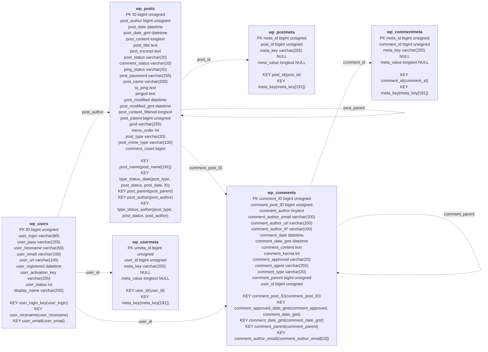

# Core Content Schema

This is the physical WordPress core substrate most immediately relevant to
local-object projection. It deliberately does not state an ActivityStreams
mapping. The arrows show logical references inferred from the column meaning;
WordPress core does not declare foreign keys for them.

## Well-known core post-meta rows

The following are examples of `wp_postmeta.meta_key` values used by core
features. They are neither an exhaustive registry nor columns in `wp_postmeta`;
their presence depends on the post type and feature used.

```mermaid
flowchart TB
    postmeta["wp_postmeta<br/>meta_key / meta_value rows"]

    thumbnail["_thumbnail_id<br/>attachment post ID"]
    template["_wp_page_template<br/>template slug or path"]
    editlast["_edit_last<br/>WordPress user ID"]
    editlock["_edit_lock<br/>timestamp:user ID string"]
    oldslug["_wp_old_slug<br/>previous slug"]
    trashstatus["_wp_trash_meta_status<br/>previous post status"]
    trashtime["_wp_trash_meta_time<br/>trash timestamp"]
    attachedfile["_wp_attached_file<br/>relative uploads path"]
    attachmentmetadata["_wp_attachment_metadata<br/>serialized attachment data"]
    imagealt["_wp_attachment_image_alt<br/>image alternative text"]
    backupsizes["_wp_attachment_backup_sizes<br/>serialized image-edit backups"]

    postmeta --> thumbnail
    postmeta --> template
    postmeta --> editlast
    postmeta --> editlock
    postmeta --> oldslug
    postmeta --> trashstatus
    postmeta --> trashtime
    postmeta --> attachedfile
    postmeta --> attachmentmetadata
    postmeta --> imagealt
    postmeta --> backupsizes
```

Two examples are logical references rather than core foreign keys:
`_thumbnail_id` identifies another `wp_posts` row whose `post_type` is normally
`attachment`, and `_edit_last` identifies a `wp_users` row. Attachment rows
are ordinary `wp_posts` rows; their attachment-page setting does not alter that
storage fact.

Source: [WordPress core `schema.php`](https://github.com/WordPress/wordpress-develop/blob/trunk/src/wp-admin/includes/schema.php).
