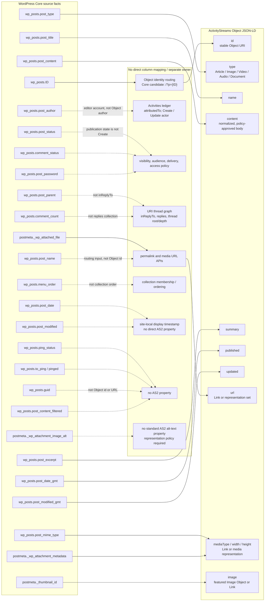

# Core Post To AS2 Object Mapping

This view records the proposed source boundary for a local `WP_Post` projected
as an ActivityStreams Object. It is not a claim that WordPress and AS2 have an
isomorphic schema: source facts, identity routing, activity history, access
policy, and collection queries have distinct owners.

Solid arrows are source-to-property transformations. Dashed arrows terminate
at an intentional non-mapping or a separately owned input. They are as
important as the solid arrows: a plausible WordPress column must not silently
acquire an ActivityStreams meaning.

## Reading the diagram

### Direct source transformations

| WordPress source fact | ActivityStreams member | boundary |
|---|---|---|
| `ID` | `id` | Not a raw cast. Core supplies a stable source-identity candidate; routing owns the final Object URI. |
| `post_type` plus `post_mime_type` | `type` | Core classification is mechanical for `post` and `attachment`; arbitrary CPTs need an explicit owning transformer. |
| `post_title` | `name` | Plain-text normalization belongs in representation policy. |
| `post_content` | `content` | The future body path parses authored blocks and emits allowed static HTML. It must not treat `the_content` output as source truth. |
| `post_excerpt` | `summary` | A manual excerpt is source material. Automatic excerpt invention remains a representation decision. |
| GMT dates | `published`, `updated` | These are the only dates used for protocol time properties in this mapping. |
| attachment meta through Core APIs | `url`, `mediaType`, `width`, `height`, `image` | Raw file paths and serialized metadata do not leave the source adapter directly. |

### Intentional non-mappings

`post_author` is a WordPress editing account, not `attributedTo`; the Activities
ledger owns the Actor selected for an Object and lifecycle activity. `post_parent`
is not `inReplyTo`; a URI thread graph owns reply relationships. `post_status`
does not mean a `Create` Activity, and `comment_count` does not constitute an
AS2 `replies` collection. `guid` and `post_name` are neither automatically the
AS2 `id` nor `url`.

AS2 properties with no direct Core-post column include `attributedTo`, `to`,
`cc`, `audience`, `attachment`, `tag`, `inReplyTo`, `replies`, `context`, and
`location`. They need a ledger, policy, parser, taxonomy/relationship source,
or another explicit domain owner rather than a convenient fallback.

`nameMap`, `contentMap`, and `summaryMap` are not ActivityStreams 2.0
Vocabulary properties. A multilingual representation extension may introduce
them later, but it must be labelled as an extension with its own language and
canonical-text policy.

Sources: [ActivityStreams 2.0 Vocabulary](https://www.w3.org/TR/activitystreams-vocabulary/),
[WordPress core `schema.php`](https://github.com/WordPress/wordpress-develop/blob/trunk/src/wp-admin/includes/schema.php),
and [the decided Core source boundary](../plugins/axismundi-object-projections/docs/CORE-WP-OBJECT-SOURCES.md).
