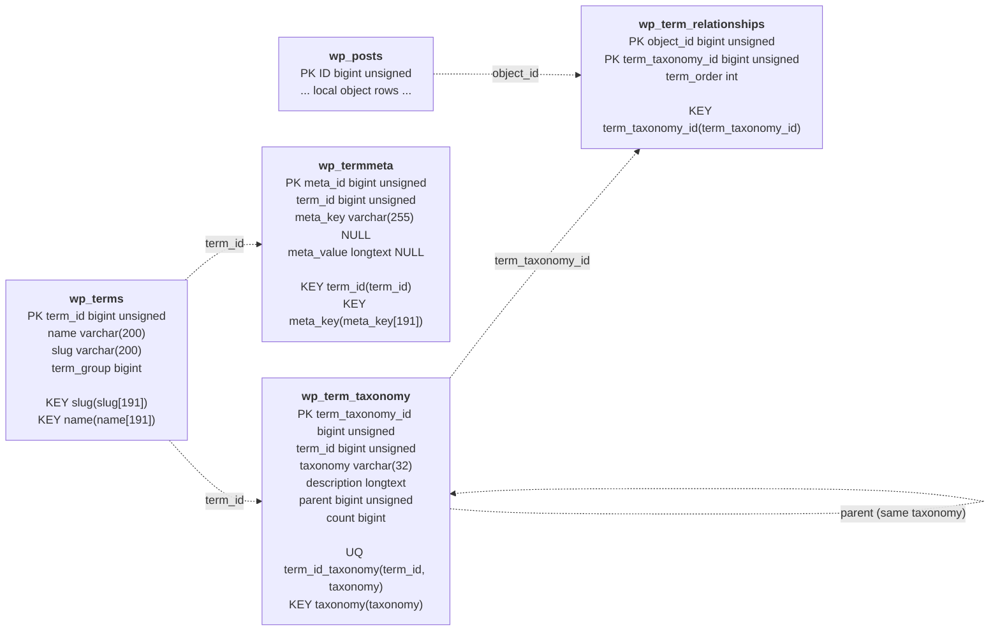

# Core Taxonomy Schema

WordPress taxonomy separates a term's shared lexical identity from its use in a
particular taxonomy. This is a local classification substrate. It does not by
itself model an ActivityStreams Collection, remote membership, actor authority,
or canonical collection URI.

`wp_term_relationships.object_id` is intentionally generic: WordPress can use
it for objects other than posts. The diagram shows `wp_posts.ID` because that is
the relationship relevant to local content and attachment classification.

Source: [WordPress core `schema.php`](https://github.com/WordPress/wordpress-develop/blob/trunk/src/wp-admin/includes/schema.php).
